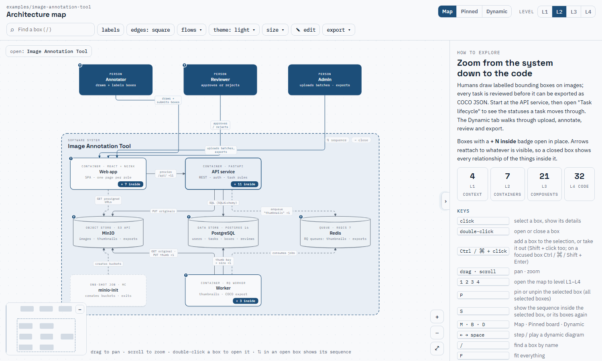
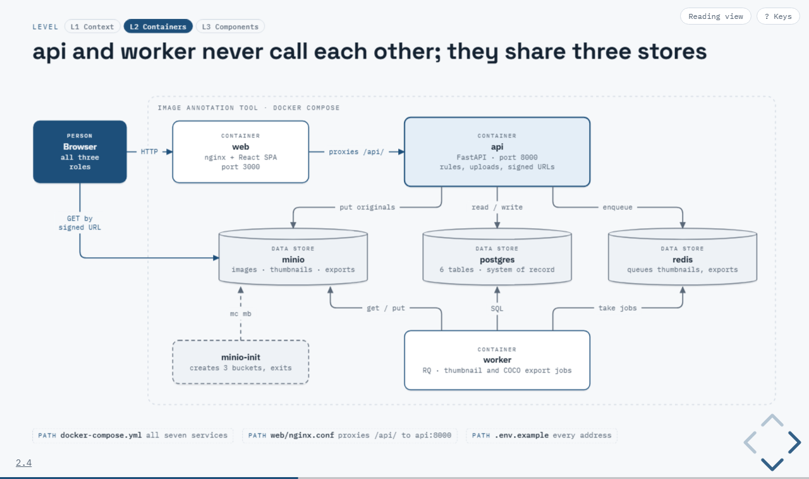
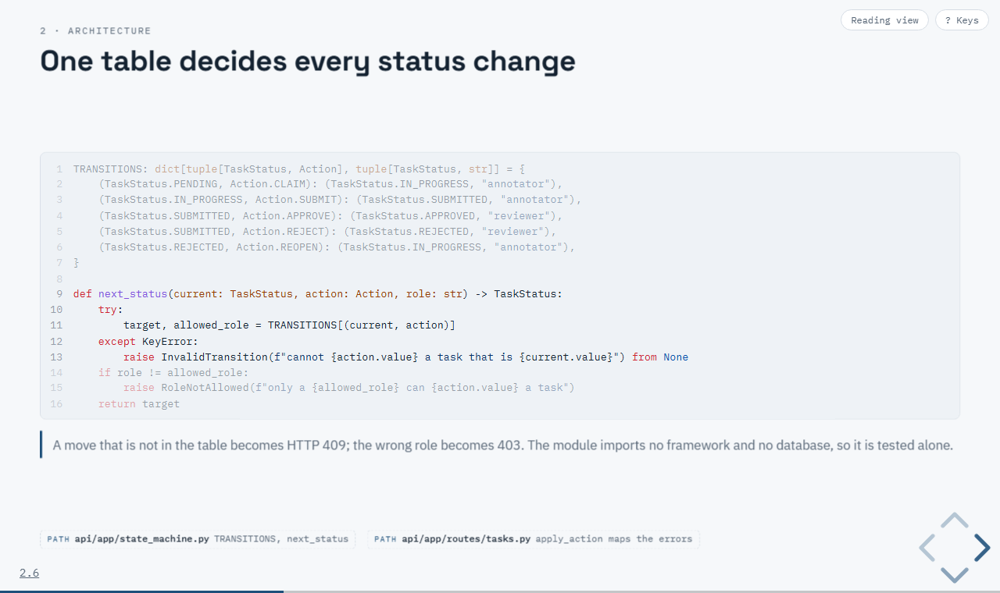

# c4-model-agentic-plugin

A Claude Code plugin that explores any codebase and generates two self-contained, interactive
HTML pages:

- **Project deck**: a reveal.js slide deck that explains what the project is about.
- **Architecture explorer**: a C4 model page for drilling from system context down to code, with
  the architecture also available as an RDF graph (JSON-LD and [rete](https://github.com/caviri/rete) downloads).

Each output is a single HTML file. The reader needs no server and no build step.

**Documentation and live example:** [caviri.github.io/c4-model-agentic-plugin](https://caviri.github.io/c4-model-agentic-plugin/)



## Install

In Claude Code:

```
/plugin marketplace add caviri/c4-model-agentic-plugin
/plugin install c4-model-agentic-plugin@c4-model-agentic-plugin
```

To try it from a local clone without installing:

```sh
git clone https://github.com/caviri/c4-model-agentic-plugin
claude --plugin-dir ./c4-model-agentic-plugin
```

### Requirements

- **Python 3** to build the deck (standard library only).
- **Node.js 18+** to build and validate the explorer. Optional: without it, Claude pastes the
  model into the template by hand.
- **Chrome or Edge**, optional, so Claude can screenshot its own output and fix layout problems.

## Use

Open Claude Code in the project you want documented and run:

```
/c4-model-agentic-plugin:explain-project
```

| Command | Result |
|---|---|
| `/c4-model-agentic-plugin:explain-project` | Both outputs, for a new developer |
| `/c4-model-agentic-plugin:explain-project deck` | Only the deck |
| `/c4-model-agentic-plugin:explain-project explorer` | Only the explorer |
| `/c4-model-agentic-plugin:explain-project both for stakeholders, focus on the review flow` | Free text sets audience and emphasis |

Plain requests work too: "explain this project as a deck", "build an architecture explorer for
this repository".

### What happens

1. **Explore.** Claude reads the repository from the outside in: README, deployment files,
   manifests, entrypoints, then the main flows.
2. **Ask.** It asks a few scoping questions (audience, scope, which flows matter) and shows you
   its one-paragraph summary and container list to correct.
3. **Brief.** It writes `communications/project-brief.md`: actors, external systems, containers,
   components, relationships, state machines and flows, each with a file reference.
4. **Generate.** It builds the deck and the explorer from the brief, then opens them in a
   headless browser to check them.

### Output

```
communications/
  project-brief.md
  project-deck/
    index.html              the deck
    src/                    slide source, figure code, build script
  architecture-explorer/
    index.html              the explorer
    model.js                the architecture model it was built from
    architecture.jsonld     the same model as an RDF graph
    architecture.rete       written when the rete CLI or npm package is available
```

Open either `index.html` directly from disk, or publish the folder on any static host.

## The deck


Slides are written from a template of ready-made patterns: text and cards, comparison, C4 level
slides that zoom into each other, step-through diagrams, sequence diagrams, code with
line-by-line highlighting, tables and a folder map. Diagrams are SVG, drawn by a small
dependency-free Python library that warns about text that does not fit, arrows through boxes
and labels that overrun.

| | |
|---|---|
|  |  |
|  | |

Rebuild a deck after editing its source:

```sh
cd communications/project-deck/src
python -B figures.py figs.json
python -B build.py deck.src.html --figs figs.json
```

- `--static` builds a version without step-by-step reveals, for reading and printing.
- `--inline-js DIR` embeds reveal.js so the deck works offline. By default reveal.js loads from a
  CDN; without a connection the deck falls back to a plain scrolling page.

## The explorer

The whole page is driven by one data block, `window.MODEL`, holding nodes, relationships,
scenarios and state machines. Layout is automatic; positions can be pinned where needed.

- **Map**: open boxes in place from context (L1) to containers, components and code (L4), with
  pan, zoom, a minimap and search.
- **Arrow styles**: squared arrows that run in the gaps between boxes on separate lanes, so they
  do not lie on top of each other, or straight arrows that bend around boxes. Squared is the
  default; switch with the `edges` button or the `E` key, or set `view.edges` in the model.
- **Details panel**: description, technology, source link, what a node uses and what uses it.
- **State machines**: a lifecycle is drawn as states and transitions inside the box that owns it.
- **Scenarios**: step through or play a flow as a collaboration diagram, a sequence diagram or a
  table, or draw the sequence inside a box on the map. A picker lists every scenario.
- **Pinned board**: collect the nodes you care about into one view.
- **Light and dark themes**, keyboard shortcuts, and every view addressable through the URL.

| | |
|---|---|
|  |  |
|  | |

Rebuild an explorer after editing its model, from the project root:

```sh
node <plugin>/skills/architecture-explorer/scripts/build-explorer.mjs   communications/architecture-explorer/model.js   communications/architecture-explorer/index.html --root .
```

The build validates the model, checks every source path, reports arrows that bend or cross, and
writes `architecture.jsonld`. `scripts/screenshot.mjs` captures any view with headless Chrome or
Edge.

### RDF export


The architecture model is also an RDF graph. The explorer's export control downloads it as:

- **JSON-LD**, generated in the browser.
- **`.rete`**, a single-file RDF graph you can host anywhere and query with SPARQL without a
  database server. It is built in the browser with [rete](https://github.com/caviri/rete); this
  one button needs a network connection, the rest of the page does not.

The build also writes `architecture.jsonld` beside the page, and `architecture.rete` when the
`rete` CLI or the `rete-graph` npm package is installed. Otherwise:

```sh
rete build architecture.jsonld -o architecture.rete --card --title "My project architecture"
```

The vocabulary, the mapping from the model and example SPARQL queries are in
[`skills/architecture-explorer/references/rdf-graph.md`](skills/architecture-explorer/references/rdf-graph.md).

## Example

[`examples/image-annotation-tool/`](examples/image-annotation-tool/) is a small theoretical
project (people annotate images, every annotation is reviewed; web app, API, worker, Postgres,
Redis and MinIO in Docker Compose). It is not meant to be run. It is the test fixture for the
plugin, and its [`communications/`](examples/image-annotation-tool/communications/) folder holds
the output the plugin produced for it. The screenshots above come from there.

To regenerate it:

```sh
cd examples/image-annotation-tool
claude --plugin-dir ../..
> /c4-model-agentic-plugin:explain-project
```

## Repository layout

```
.claude-plugin/           plugin and marketplace manifests
commands/                 /explain-project
skills/
  explore-project/        how to explore, what to ask, the brief template
  project-deck/           deck template, build and diagram scripts, guides
  architecture-explorer/  explorer template, build and check scripts, references
examples/
  image-annotation-tool/  test fixture and its generated output
docs/img/                 screenshots
```

| Skill | Reference guides |
|---|---|
| `explore-project` | exploration playbook, question bank, brief template |
| `project-deck` | deck structure, animated versus static, code slides, diagrams and images |
| `architecture-explorer` | data model, features and layout, RDF graph |

## Background: the C4 model

The four levels the explorer draws (system context, containers, components and code) are the
[C4 model](https://c4model.com/), created by [Simon Brown](https://simonbrown.je). It grew out of the
software architecture workshops he ran from the mid-2000s, and the name "C4" first appeared in his
QCon London workshop in March 2011. This plugin is an independent project, not affiliated with or
endorsed by Simon Brown.

- [c4model.com](https://c4model.com/): the official site, with the abstractions, diagram types,
  notation, FAQ and history.
- [Visualising software architecture with the C4 model](https://www.youtube.com/watch?v=x2-rSnhpw0g):
  Simon Brown's talk at Agile on the Beach, July 2019.
- [The C4 model](https://www.oreilly.com/library/view/the-c4-model/9798341660113/): Simon Brown's
  book, on O'Reilly.
- [simonbrown.je](https://simonbrown.je): his site, with talks, writing and C4 workshops.

## License

[Apache-2.0](LICENSE).
