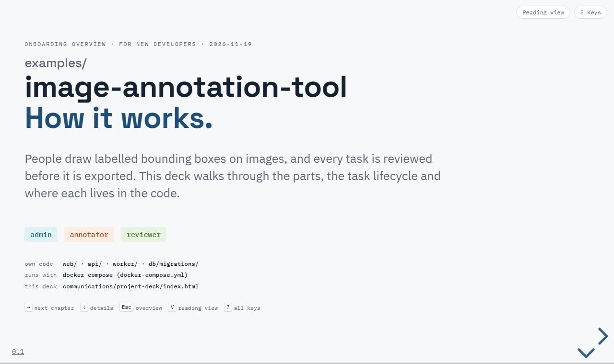
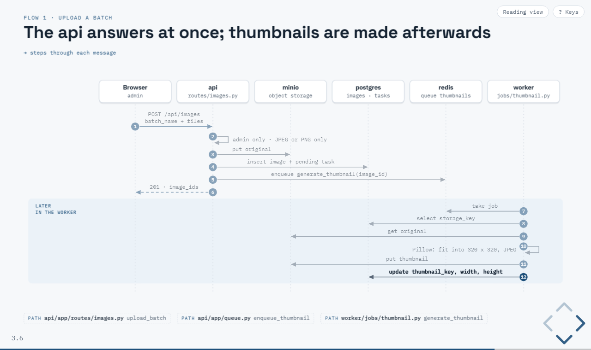
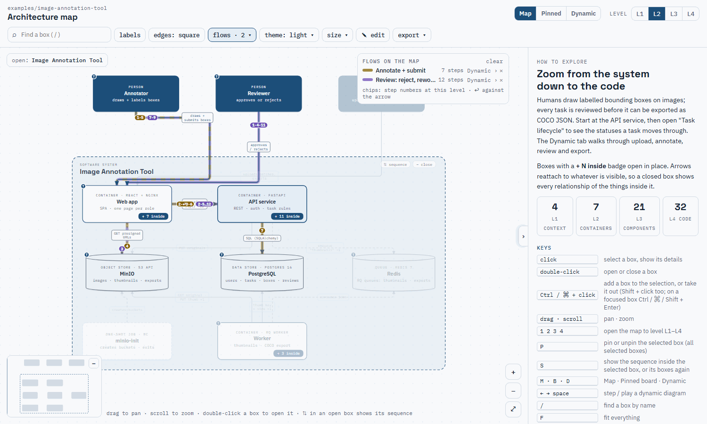
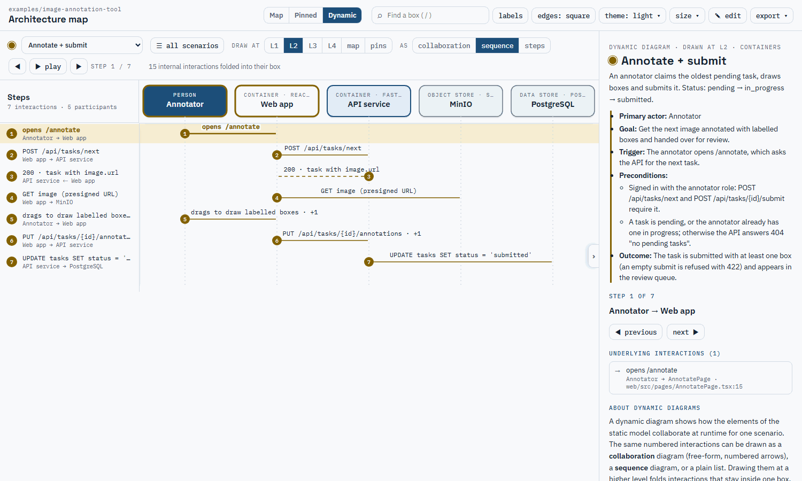
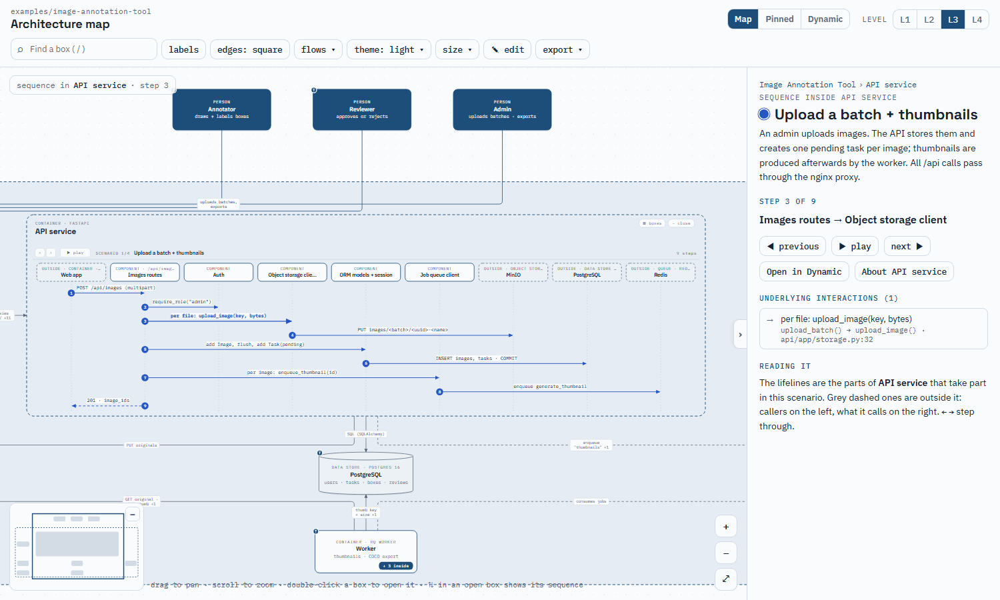
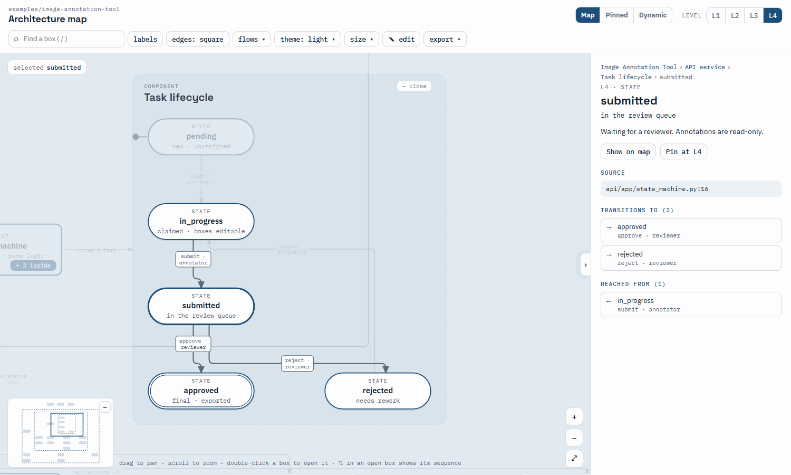
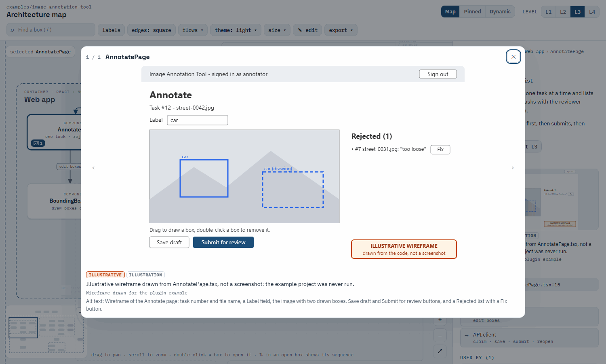
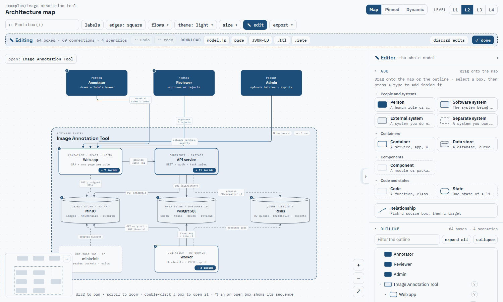
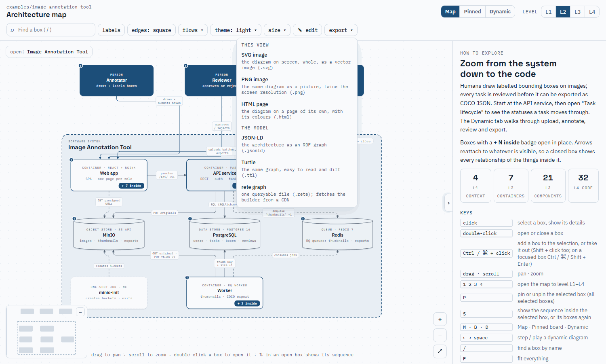
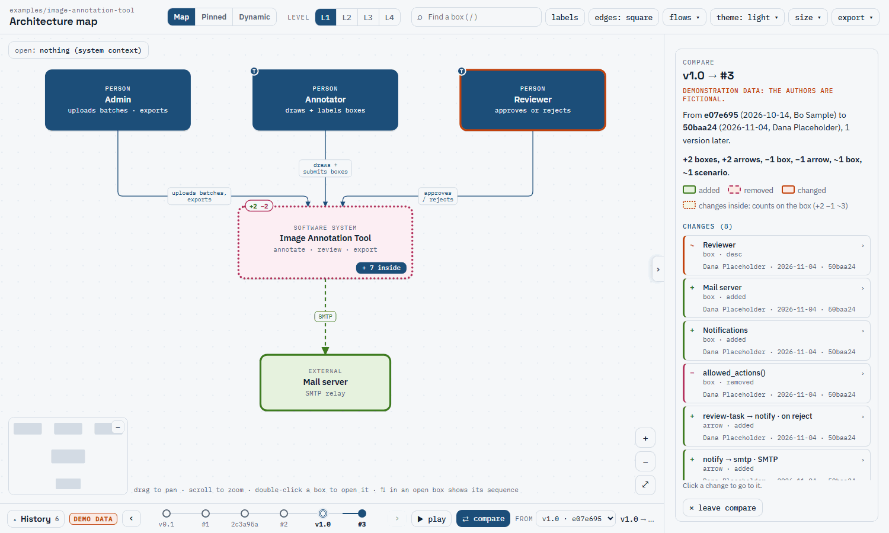

# c4-model-agentic-plugin

A Claude Code plugin that explores any codebase, writes a brief of what it found, and generates two
self-contained, interactive HTML pages:

- **Project deck**: a reveal.js slide deck that explains what the project is about.
- **Architecture explorer**: a C4 model page for drilling from system context down to code, with runtime flows,
  state machines, pictures of what users see, and an editor of its own model.

Around them:

- the architecture as an **RDF graph** (Turtle, JSON-LD, N-Triples, [rete](https://github.com/caviri/rete)) in a
  published **C4 ontology**, from which the page can be rebuilt;
- its **history** from git: versions with provenance, diffs between commits, branches and pull requests, blame, and
  a compare mode in the explorer;
- an **MCP server** that brings the explorer to ChatGPT and Claude, drawn inside the chat.

Each page is one HTML file (pictures, if any, sit in an `img/` folder beside it or inside the page). The reader needs
no server and no build step.

**Documentation and live example:** [caviri.github.io/c4-model-agentic-plugin](https://caviri.github.io/c4-model-agentic-plugin/)


## Install

Let your agent do it: paste this into Claude Code.

```text
Install the Claude Code plugin c4-model-agentic-plugin for me.
Read https://raw.githubusercontent.com/caviri/c4-model-agentic-plugin/main/INSTALL.md
and follow its "Steps for the agent" section exactly. When you are done, tell me
what you ran, what you checked, and how I start using the plugin.
```

[INSTALL.md](INSTALL.md) has the agent's steps, team installs, updating and removing.

Or install it yourself, in Claude Code:

```
/plugin marketplace add caviri/c4-model-agentic-plugin
/plugin install c4-model-agentic-plugin@c4-model-agentic-plugin
```

To try it from a local clone without installing:

```sh
git clone https://github.com/caviri/c4-model-agentic-plugin
claude --plugin-dir ./c4-model-agentic-plugin
```

### Requirements

- **Python 3** to build the deck (standard library only).
- **Node.js 18+** to build and validate the explorer, and (with git) to build its history. Optional for the
  explorer: without it, Claude pastes the model into the template by hand.
- **Chrome or Edge**, optional, so Claude can screenshot its own output and fix layout problems.

## Use

Open Claude Code in the project you want documented and run:

```
/c4-model-agentic-plugin:explain-project
```

| Command | Result |
|---|---|
| `/c4-model-agentic-plugin:explain-project` | Both outputs, for a new developer |
| `/c4-model-agentic-plugin:explain-project deck` | Only the deck |
| `/c4-model-agentic-plugin:explain-project explorer` | Only the explorer |
| `/c4-model-agentic-plugin:explain-project both for stakeholders, focus on the review flow` | Free text sets audience and emphasis |

Plain requests work too: "explain this project as a deck", "build an architecture explorer for
this repository".

### What happens

1. **Explore.** Claude reads the repository from the outside in: README, deployment files,
   manifests, entrypoints, then the main flows.
2. **Ask.** It asks a few scoping questions (audience, scope, which flows matter) and shows you
   its one-paragraph summary and container list to correct.
3. **Brief.** It writes `communications/project-brief.md`: actors, external systems, containers,
   components, relationships, state machines and flows, each with a file reference.
4. **Generate.** It builds the deck and the explorer from the brief, then opens them in a
   headless browser to check them.

### Output

```
communications/
  project-brief.md
  project-deck/
    index.html              the deck
    src/                    slide source, figure code, build script
  architecture-explorer/
    index.html              the explorer
    model.js                the architecture model it was built from
    architecture.jsonld     the same model as an RDF graph
    architecture.ttl        the same graph in Turtle
    architecture.rete       written when the rete CLI or npm package is available
    img/                    pictures the model shows, if any
```

Open either `index.html` directly from disk, or publish the folder on any static host. Commit `model.js` with the
code: `/c4-model-agentic-plugin:architecture-history` then follows how the architecture changes
([History and diffs](#history-and-diffs)).

## The deck



Slides are written from a template of ready-made patterns: text and cards, comparison, C4 level
slides that zoom into each other, step-through diagrams, sequence diagrams, code with
line-by-line highlighting, tables and a folder map. Diagrams are SVG, drawn by a small
dependency-free Python library that warns about text that does not fit, arrows through boxes
and labels that overrun.

| | |
|---|---|
|  |  |
|  | |

Rebuild a deck after editing its source:

```sh
cd communications/project-deck/src
python -B figures.py figs.json
python -B build.py deck.src.html --figs figs.json
```

- `--static` builds a version without step-by-step reveals, for reading and printing.
- `--inline-js DIR` embeds reveal.js so the deck works offline. By default reveal.js loads from a
  CDN; without a connection the deck falls back to a plain scrolling page.

## The explorer

The whole page is driven by one data block, `window.MODEL`, holding nodes, relationships,
scenarios, state machines and pictures. Layout is automatic; positions can be pinned where needed.

- **Map**: open boxes in place from context (L1) to containers, components and code (L4), with
  pan, zoom, a minimap and search.
- **Arrow styles**: squared arrows that run in the gaps between boxes on separate lanes, so they
  do not lie on top of each other, or straight arrows that bend around boxes. Squared is the
  default; switch with the `edges` button or the `E` key, or set `view.edges` in the model. A label
  that would overlap folds into a `···` marker that shows it on hover.
- **Selection**: Ctrl, ⌘ or Shift + click selects several boxes; only they, what is inside them and
  what they connect to stay bright.
- **Details panel**: description, technology, source link, what a node uses and what uses it. It
  folds away (`I`), and the minimap shrinks to a chip (`O`).
- **State machines**: a lifecycle is drawn as states and transitions inside the box that owns it.
- **Scenarios**: step through or play a flow as a collaboration diagram, a sequence diagram or a
  step table, or draw the sequence inside a box on the map. Each has a colour of its own and can
  carry a use case (actor, goal, trigger, preconditions, outcome). A picker lists every scenario.
- **Flows on the map**: `flows ▾` (`W`) paints one or several scenarios on the map's arrows, each in
  its colour, with numbered chips.
- **Images**: screenshots, diagrams, photos or mock-ups labelled *illustrative* on a box, an arrow,
  a scenario or a step, in a gallery and a full-size viewer.
- **Pinned board**: collect the nodes you care about into one view.
- **Six colour themes** (or follow the system), a size menu for the interface, spacing and labels,
  keyboard shortcuts, and every view addressable through the URL.
- **Export** the view on screen as SVG, PNG or an HTML page, or the model as an RDF graph.
- **Edit mode** (`✎ edit`): an editor sidebar with an Add section to drag new boxes onto the map,
  an outline of the whole model to reorder and re-parent by drag, and the properties of what is
  selected. Every change is validated and undoable; download the new `model.js`, the page or the graph.

| | |
|---|---|
|  |  |
|  |  |
|  |  |

The example's pictures are wireframes labelled illustrative: that project was never run.
Every shortcut and URL parameter is listed in the
[explorer guide](https://caviri.github.io/c4-model-agentic-plugin/explorer/).

Rebuild an explorer after editing its model, from the project root:

```sh
node <plugin>/skills/architecture-explorer/scripts/build-explorer.mjs \
  communications/architecture-explorer/model.js \
  communications/architecture-explorer/index.html --root .
```

The build validates the model, checks every source path and image, reports arrows that bend or
cross, and writes `architecture.jsonld` and `architecture.ttl`. `scripts/screenshot.mjs` captures
any view with headless Chrome or Edge.

### RDF export



The architecture model is also an RDF graph. The explorer's export menu downloads it as:

- **JSON-LD** or **Turtle**, generated in the browser.
- **`.rete`**, a single-file RDF graph you can host anywhere and query with SPARQL without a
  database server. It is built in the browser with [rete](https://github.com/caviri/rete); this
  one button needs a network connection, the rest of the page does not.

The build also writes `architecture.jsonld` and `architecture.ttl` beside the page, and
`architecture.rete` when the `rete` CLI or the `rete-graph` npm package is installed. Otherwise:

```sh
rete build architecture.ttl -o architecture.rete --card --title "My project architecture"
```

The vocabulary, the mapping from the model and example SPARQL queries are in
[`skills/architecture-explorer/references/rdf-graph.md`](skills/architecture-explorer/references/rdf-graph.md).

## Ontology

The graph's terms are the plugin's own **C4 architecture ontology** (OWL 2), in [`ontology/`](ontology/) and
published at [caviri.github.io/c4-model-agentic-plugin/ontology](https://caviri.github.io/c4-model-agentic-plugin/ontology/):

- [`c4.ttl`](ontology/c4.ttl), namespace `c4:`: the architecture (people, software systems, containers, data
  stores, components, code, relationships, scenarios and steps, states, use cases, images);
- [`c4-view.ttl`](ontology/c4-view.ttl), namespace `c4v:`: how the explorer draws it, so a page can be recreated
  from its graph alone;
- [`c4-shapes.ttl`](ontology/c4-shapes.ttl): SHACL shapes every exported graph meets;
- [`EXTENDING.md`](ontology/EXTENDING.md): how to add terms of your own, with a worked example.

The graph is lossless: `build-explorer.mjs` rebuilds the same page from a graph file, and `check-roundtrip.mjs` proves
it. A model can add terms of its own vocabulary through an `rdf` hook. [`ontology/README.md`](ontology/README.md)
explains the ontology; the C4 model itself is Simon Brown's, and this is an independent formalisation of it.

## History and diffs

Committed with the code, the explorer's `model.js` has a history. The **architecture-history** skill turns it into
versions with provenance and shows how the architecture changed:

```text
> /c4-model-agentic-plugin:architecture-history                         # timeline of this branch, one version per merge
> /c4-model-agentic-plugin:architecture-history timeline tags           # one version per release
> /c4-model-agentic-plugin:architecture-history diff main feature/x     # two branches
> /c4-model-agentic-plugin:architecture-history pr 42                   # a pull request's architecture impact
```

- **In the explorer** (`build-explorer.mjs --history history.json`): a history bar along the bottom to step through
  or play the versions, a drawer listing each version's message, authors, pull request and changes, and a compare mode
  that draws added boxes and arrows in green, removed ones as red ghosts and changed ones in amber, with every change
  listed with its author and commit; a click on a change goes to it. Changes roll up: a closed box shows the counts of
  everything changed inside it, so a change deep in the code is visible at the system context. `#ver=`, `#cmp=` and
  `#hist=open` in the URL.
- **Reports**: Markdown diffs for two refs or a pull request, a timeline, and blame for every element.
- **Dataset**: `history.trig` (RDF 1.2), `history.nq`, `history.rete`. Each version is a named graph; PROV-O says who
  made it, when, and in which commit, merge, release or pull request; every added or removed triple has a reifier
  naming the commit and author. Terms: [`ontology/c4-history.ttl`](ontology/c4-history.ttl) (`c4h:`), checked by
  [`c4-history-shapes.ttl`](ontology/c4-history-shapes.ttl).
- **Refs without a model, or with an outdated one**, are listed with the files that changed and the boxes they map
  to; the skill regenerates those models incrementally in a worktree outside your checkout.
- Authors are exported by **name only**; `--emails` adds addresses.



*Demonstration data from `make-demo-history.mjs`: the authors are fictional and the dates invented.*

Details: [`skills/architecture-history/`](skills/architecture-history/) and
[History and diffs](https://caviri.github.io/c4-model-agentic-plugin/history/) in the documentation.

## ChatGPT and Claude (MCP)

Not using Claude Code? [`mcp/`](mcp/) is a remote **MCP server** that brings the same method to ChatGPT, Claude (web
and desktop) or any MCP client. The assistant explores a public GitHub repository, writes the model, checks it with
the explorer's own validator, the ontology's SHACL shapes and the real file paths, and **draws the explorer inline in
the chat** as an interactive view (MCP Apps). It also exports Turtle, JSON-LD, N-Triples and `.rete`, and the
standalone page.

- Add it as a custom connector in Claude (Customize → Connectors) or as a custom MCP server in ChatGPT, with the
  server's URL ending in `/mcp`. Locally (Node 20+): `node mcp/server.mjs --stdio`.
- Stateless: models are never stored. Only public GitHub content is fetched, and only when the assistant asks.
- Host it with [`mcp/Dockerfile`](mcp/Dockerfile) or as a Hugging Face Space ([`mcp/deploy/huggingface/`](mcp/deploy/huggingface/)).

The explorer and the deck are also **WebMCP** pages: in a browser with `document.modelContext` (Chrome behind a flag
or origin trial) an in-browser agent can read the model, open levels, select boxes, show scenarios or turn slides,
and, in the explorer's edit mode, propose edits you confirm on the page. Elsewhere nothing changes.

Details: [`mcp/README.md`](mcp/README.md) and
[ChatGPT and Claude (MCP)](https://caviri.github.io/c4-model-agentic-plugin/mcp/) in the documentation.

## Example

[`examples/image-annotation-tool/`](examples/image-annotation-tool/) is a small theoretical
project (people annotate images, every annotation is reviewed; web app, API, worker, Postgres,
Redis and MinIO in Docker Compose). It is not meant to be run. It is the test fixture for the
plugin, and its [`communications/`](examples/image-annotation-tool/communications/) folder holds
the output the plugin produced for it, with the model's real history (three committed versions).
The explorer and deck screenshots above come from there; the history screenshot comes from the
demonstration repository. Its pictures are wireframes labelled illustrative, drawn from the code,
because the project was never run.

To regenerate it:

```sh
cd examples/image-annotation-tool
claude --plugin-dir ../..
> /c4-model-agentic-plugin:explain-project
```

## Repository layout

```
.claude-plugin/           plugin and marketplace manifests
commands/                 /explain-project, /architecture-history
skills/
  explore-project/        how to explore, what to ask, the brief template
  project-deck/           deck template, build and diagram scripts, guides
  architecture-explorer/  explorer template, build and check scripts, references
  architecture-history/   versions, diffs and blame from git; the demonstration history
ontology/                 the C4 ontology: core, view and history modules, SHACL shapes
mcp/                      remote MCP server with an MCP Apps view (ChatGPT, Claude), Dockerfile, tests
examples/
  image-annotation-tool/  test fixture and its generated output
docs/                     the documentation site (MkDocs); docs/img holds the screenshots
INSTALL.md                install steps, with a message to paste to your agent
```

| Skill | Reference guides |
|---|---|
| `explore-project` | exploration playbook, question bank, brief template |
| `project-deck` | deck structure, animated versus static, code slides, diagrams and images |
| `architecture-explorer` | data model, features and layout, RDF graph |
| `architecture-history` | workflows, history graph |

## Background: the C4 model

The four levels the explorer draws (system context, containers, components and code) are the
[C4 model](https://c4model.com/), created by [Simon Brown](https://simonbrown.je). It grew out of the
software architecture workshops he ran from the mid-2000s, and the name "C4" first appeared in his
QCon London workshop in March 2011. This plugin is an independent project, not affiliated with or
endorsed by Simon Brown.

- [c4model.com](https://c4model.com/): the official site, with the abstractions, diagram types,
  notation, FAQ and history.
- [Visualising software architecture with the C4 model](https://www.youtube.com/watch?v=x2-rSnhpw0g):
  Simon Brown's talk at Agile on the Beach, July 2019.
- [The C4 model](https://www.oreilly.com/library/view/the-c4-model/9798341660113/): Simon Brown's
  book, on O'Reilly.
- [simonbrown.je](https://simonbrown.je): his site, with talks, writing and C4 workshops.

## License

[Apache-2.0](LICENSE).
