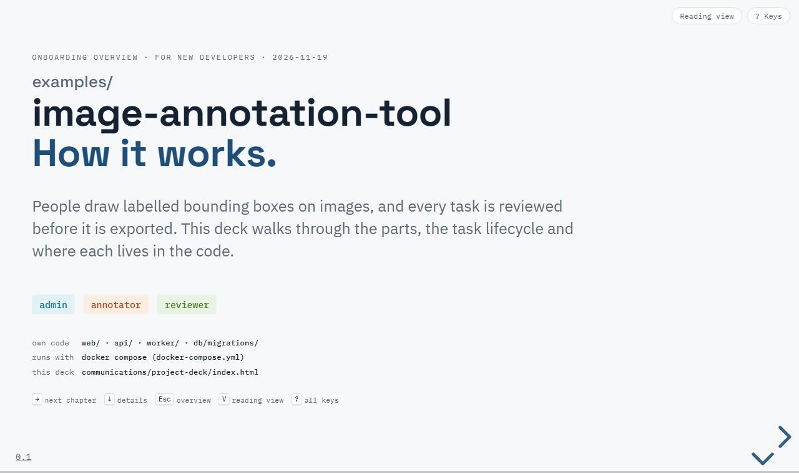
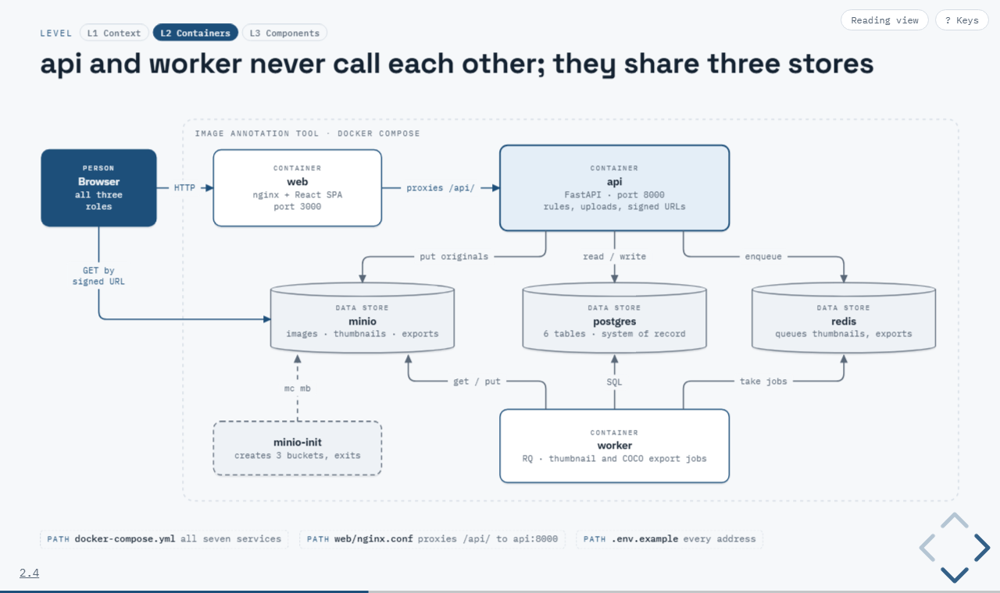
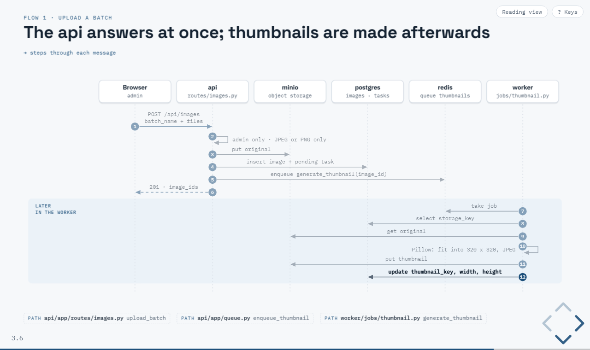
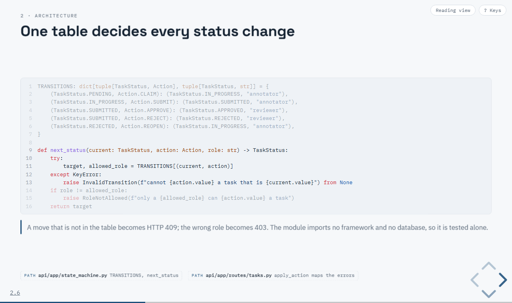

# Project deck

A reveal.js deck in one HTML file that explains what a project is about: its purpose, its users, the architecture
at a glance, the main flows and where things live in the code. Chapters run left to right, details downward.

[:octicons-arrow-right-24: Flip through the live example](example/deck.md){ .md-button .md-button--primary }

{ .shot }

## Slides

Claude writes an outline first: chapters, the slide pattern for each slide, a headline sentence that states the
slide's message, the figure it needs, and where each fact comes from. Then it copies the patterns it needs from the
template: text and cards, comparison, C4 level slides that zoom into each other, step-through diagrams, sequence
diagrams, code with line-by-line highlighting, tables and a folder map.

| | |
|---|---|
| { .shot } | { .shot } |
| { .shot } | |

Diagrams are SVG, drawn by a small dependency-free Python library that warns about text that does not fit, arrows
through boxes and labels that overrun. They follow the deck's light and dark themes.

Every deck has speaker notes, a reading view that shows the slides as one scrolling page, and a keys panel.

| Key | Action |
|---|---|
| ++right++ / ++left++ | Next / previous chapter |
| ++down++ / ++up++ | Details within a chapter |
| ++"?"++ | Keys panel |
| ++v++ | Reading view |
| ++s++ | Speaker notes |

## Source and rebuild

```
communications/project-deck/
  index.html          the deck
  artifact.html       the same content without the <html> wrapper, for hosts that add their own
  src/
    deck.src.html     the slides
    figures.py        the diagrams, one per FIG:name marker in the slides
    diagrams.py       the SVG diagram library
    build.py          the build
    reveal-5.1.0.min.css
```

Everything needed to rebuild is copied into `src/`, so the project can update its deck without the plugin:

```sh
cd communications/project-deck/src
python -B figures.py figs.json
python -B build.py deck.src.html --figs figs.json
```

Variants:

- `--static --out ../static.html` builds a version without step-by-step reveals, for reading and printing.
- `--inline-js DIR` embeds reveal.js so the deck works offline. By default reveal.js loads from a CDN; without a
  connection the deck falls back to a plain scrolling page.

## Reference

- [Structure](reference/deck-structure.md): the narrative arc, slide counts per audience, the outline format.
- [Animated or static](reference/deck-animations.md): steps, auto-animate, the variant toggle, print versions.
- [Code slides](reference/deck-code-slides.md): markup, highlighting, line steps, how much fits.
- [Diagrams and images](reference/deck-diagrams.md): choosing, drawing and sizing diagrams, screenshots.
