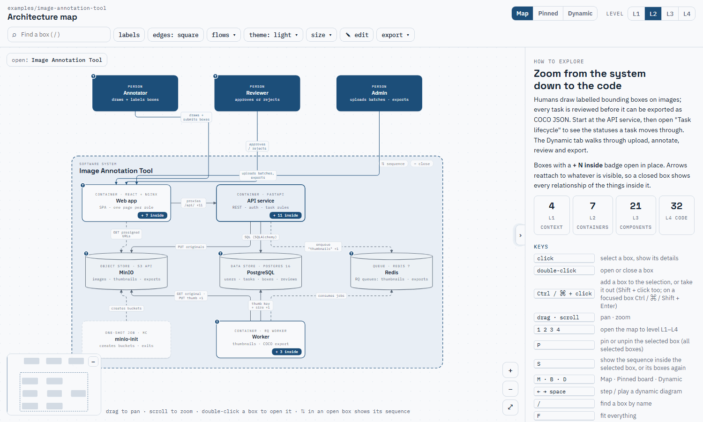
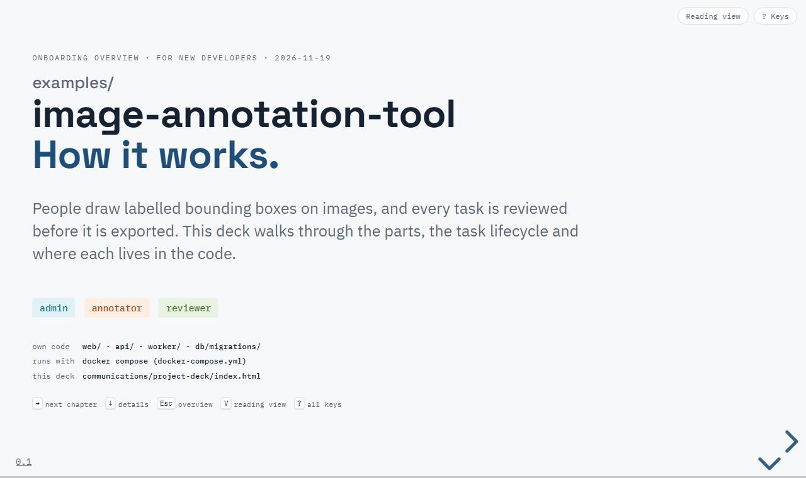

# Example: Image Annotation Tool

[`examples/image-annotation-tool/`](https://github.com/caviri/c4-model-agentic-plugin/tree/main/examples/image-annotation-tool)
is a small theoretical project, written to test the plugin. People draw labelled bounding boxes on images, a
reviewer approves or rejects every task, and approved annotations are exported as COCO JSON. It has a React web app
behind nginx, a FastAPI service, an RQ worker, PostgreSQL, Redis and MinIO, all in Docker Compose. It is not meant
to be run.

The plugin was run on it with `/c4-model-agentic-plugin:explain-project`. Everything below is its output,
unedited.

<div class="grid cards" markdown>

-   :material-sitemap-outline: **[Architecture explorer](explorer.md)**

    ---

    

    Open boxes from the system context down to code, step through four scenarios, draw a scenario inside a
    container, follow the task lifecycle, download the model as RDF.

-   :material-presentation: **[Project deck](deck.md)**

    ---

    

    A reveal.js deck for a new developer: what the tool is for, its containers, the upload, annotate, review and
    export flows, and the code that implements them.

-   :material-file-document-outline: **[Project brief](brief.md)**

    ---

    The intermediate step: actors, containers, components, relationships, the task state machine and four flows,
    each with the file it came from.

-   :material-code-braces: **[Source on GitHub](https://github.com/caviri/c4-model-agentic-plugin/tree/main/examples/image-annotation-tool)**

    ---

    The example code, and its `communications/` folder holding the generated files: `model.js` for the explorer,
    `src/` for the deck.

</div>

## Things to try in the explorer

- Press ++2++ for the containers, then double-click **API service** to open it.
- In the open box, click **⇅ sequence**: the upload scenario is drawn inside the container, with its components as
  lifelines. Press **▶ play**, or click a message to see the code behind it.
- Open **Task lifecycle** inside the API service to see the statuses a task moves through, drawn as a state machine.
- Press ++d++ for the Dynamic tab, then **☰ all scenarios** to pick one of the four flows with a description of each.
- Use **export** to download the architecture as JSON-LD, Turtle or a `.rete` graph, in the terms of the
  [ontology](../ontology/index.md).

## Regenerate it

```sh
cd examples/image-annotation-tool
claude --plugin-dir ../..
> /c4-model-agentic-plugin:explain-project
```

The documentation copies the generated `index.html` files when it is built, so a regenerated example shows up here
on the next publish.
