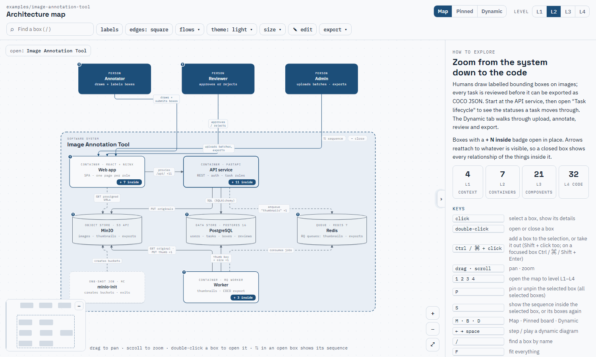
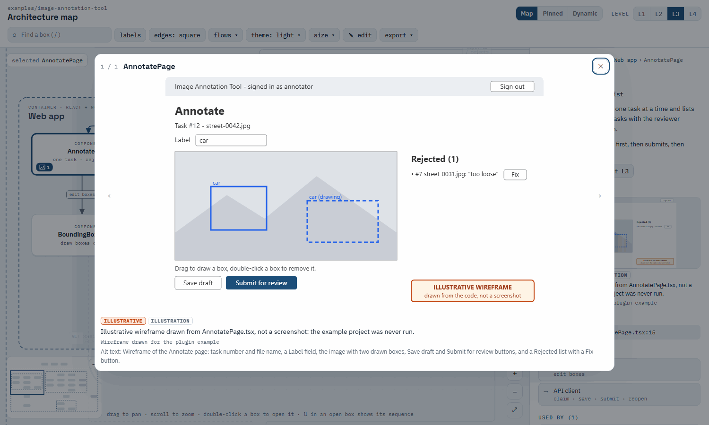
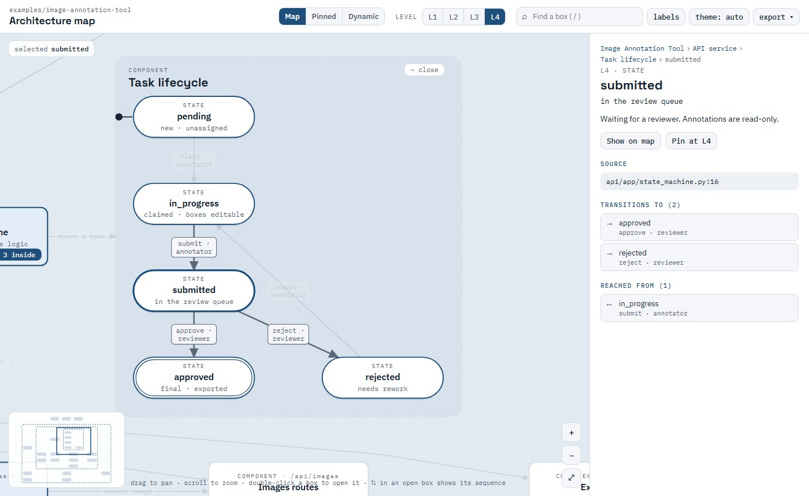
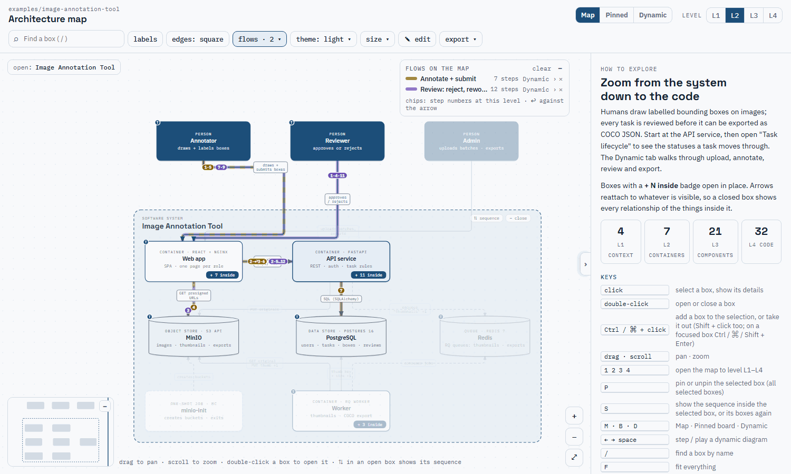
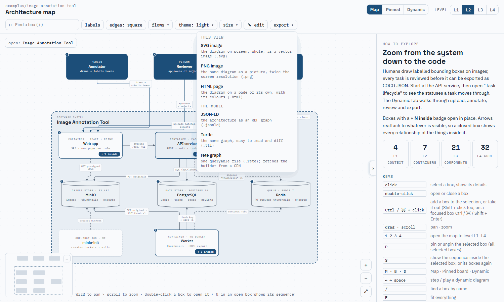
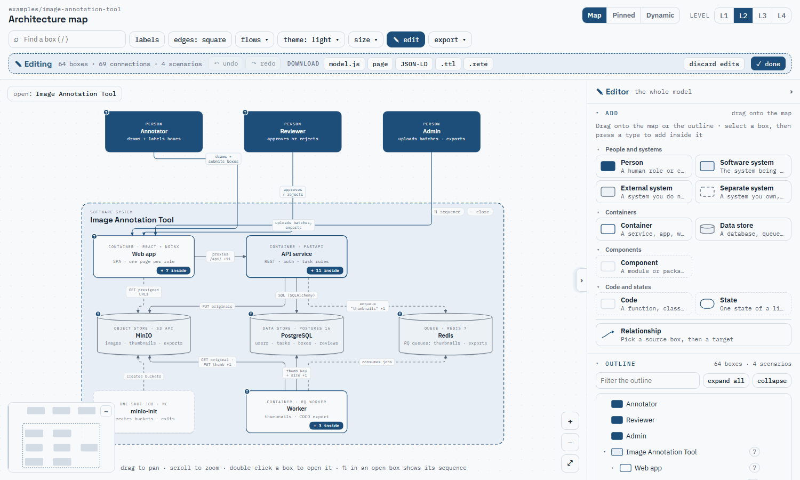

# Architecture explorer

One HTML file that lets a reader drill from the system context down to the code, C4 style. Everything
project-specific is one data block, `window.MODEL`, holding nodes, relationships, scenarios, state machines and,
optionally, pictures. The rendering engine around it never changes, so a page can be rebuilt with a newer template at
any time.

[:octicons-arrow-right-24: Open the live example](example/explorer.md){ .md-button .md-button--primary }

{ .shot }

## What readers can do

### Map

Boxes open in place: from the system context (L1) to containers (L2), components (L3) and code (L4). A box with
children shows a **+ N inside** badge; double-click it or press the badge to open it, and the boxes around it make
room. Keys ++1++ to ++4++ open the whole map to a level. Pan, zoom, a minimap and search (++"/"++) help on large
models.

Relationships are declared once, between the most specific elements known, and drawn between whatever is visible.
A closed container therefore shows every relationship of the things inside it. Arrows are **squared** by default,
running in the gaps between boxes on separate lanes; ++e++ switches to **straight** arrows that bend around boxes.
An arrow label that would still overlap another label or a box is folded into a small `···` marker on its arrow:
point at the arrow or the marker (or select one of its ends) to read it. ++l++ hides or shows the labels.

**Selecting several boxes.** ++ctrl++ + click (++cmd++ + click on macOS, or ++shift++ + click anywhere) adds a box to
the selection or takes it out. The selected boxes, everything inside them and every box at the other end of one of
their arrows stay bright, and the rest fades. The panel then lists the selected boxes, the relationships between them,
and what they use and are used by together; ++p++ pins them all.

### Details panel

Click a box to see its description, notes, technology, source file and line (linked to the repository), the boxes
inside it, and the lists of what it uses and what uses it. Every entry navigates to the other end.

The handle on the right edge of the map (or ++i++) folds the panel away and gives the views the whole width; it
stays folded when you select a box (the handle shows a dot) until you bring it back. On a phone the panel is a bottom
sheet that folds to one line. The minimap's `–` button (or ++o++) shrinks it to a small chip. Both remember their
state and appear in the URL (`#panel=closed`, `#mm=min`).

### Images

A box can carry pictures: screenshots of what a user sees, diagrams, photos, or mock-ups clearly labelled
*illustrative*. It shows a small picture badge with the count; its panel has a gallery with captions, credits and the
kind of picture, and a click on a picture or on the badge opens it in a viewer (++left++ ++right++ to move, ++esc++ to
close). Arrows, scenarios and steps can carry pictures too: a step's picture (what the user sees there) appears in
the Dynamic panel while that step is current. Images sit next to `model.js` in `img/` and the build copies them next
to the page (or `--embed-images` puts them inside it). Every image needs an alt text.

{ .shot }

*The example's pictures are wireframes drawn from the page components' code and labelled illustrative: the example
project was never run, so there is nothing to take a screenshot of.*

### State machines

A lifecycle (task statuses, order states) is drawn as states and transitions inside the box that owns it, with
the initial and final states marked.

{ .shot }

### Scenarios

The **Dynamic** tab (++d++) shows one runtime flow at a time, step by step, as a collaboration diagram, a sequence
diagram or a step table. Draw it at any level, on the boxes open on the map, or on your pinned boxes: steps that stay
inside one box are folded away. Step through with ++left++ ++right++, or play it with ++space++. **☰ all scenarios**
(++s++) lists every scenario with a short explanation, the elements it passes through and its length.

A scenario can also be read as a **use case**: its primary actor, goal, trigger, preconditions and outcome are listed
under its description in the panel, when the model has them.

{ .shot }

Every scenario has a **colour of its own**: its arrows, numbers and current step are drawn in it, and a swatch shows it
next to the picker. Set one with `color`, or let the scenarios take distinct colours by order.

### Flows on the map

**flows ▾** in the toolbar (or ++w++) paints one or several scenarios on the map, each in its colour: the arrows its
steps travel along get a coloured band under them, with chips carrying the step numbers, and the boxes they pass
through stay bright while the rest fades. Where several flows share an arrow, the band is striped in their colours and
their chips sit side by side. A legend lists the flows on, opens one in the Dynamic view, or turns it off; the URL
carries them (`#flows=upload,review`). Its `–` button folds it to a one-line chip (`#legend=min`, remembered; until you
choose, it is folded on a narrow screen). Fitting the map keeps the boxes clear of the legend, as of the minimap, the zoom buttons and
the breadcrumb, and a fitted map makes room again when the legend appears or folds, or when the window changes size.

{ .shot }

### Sequence inside a box

On the map, an open box that a scenario passes through gets a **⇅ sequence** button. Its inside becomes a sequence
diagram of that scenario: its own parts as lifelines, and the outside elements it talks to as dashed cards at the
edges (callers on the left, what it calls on the right). Switch scenario with **‹ ›**, play it with **▶ play**,
click a message for the code behind it, or select a part and show its own sequence to go one level deeper.

{ .shot }

### Pinned board, variants, themes

- **Pinned board** (++b++): pin any boxes from any level (++p++) and see only them and the relationships between
  them, one lane per level.
- **Variants**: when parts of the architecture exist only in some configurations (cloud or on-premises, a feature
  flag), a filter fades what a variant does not use.
- **Colour themes** (++t++ or the `theme ▾` menu): light and dark following the operating system by default, plus
  contrast, paper, blueprint and graphite.
- **Sizes** (`size ▾`): make the toolbars and panel smaller, spread the boxes further apart without making them
  bigger, or make the arrow labels and arrows smaller or larger. Remembered per browser.
- **Links to any view**: the URL hash records what is open and selected, the scenario and step, the flows painted,
  the theme and more (see [URL parameters](#url-parameters)), so any view can be shared, reloaded or screenshotted.

### Export a diagram

`export ▾` → **This view** saves the diagram on screen as an **SVG**, a **PNG** or an **HTML** page of its own: the
whole map (not only the part in the window), the Pinned board, or the scenario's collaboration or sequence diagram,
in the colours on screen. `export ▾` → **The model** downloads the architecture as an RDF graph: JSON-LD, Turtle or
`.rete` (see [RDF export](rdf.md)).

{ .shot }

### Edit the model in the page

`✎ edit` turns the page into an editor of its own model. A slim edit bar under the toolbar keeps undo, redo, the
downloads, `discard edits` and `✓ done`; the details panel's column becomes the **editor sidebar**, so the map keeps
its width. The sidebar folds away like the panel (++i++ or its header), its edge drags to make it wider, and on a
phone it is a bottom sheet. It has three sections that fold open and closed and remember it:

{ .shot }

- **Add**: the element types by C4 level, each drawn as its box in the current theme. **Drag** one onto the map (into
  an open box, onto a closed one, or at the top level) or into the outline: while you drag, the boxes it may go into
  are outlined, and one it may not go into is marked in red with the reason (a component goes inside a container, a
  container inside a software system, and so on). Or **press** a type (or ++enter++) to add one inside the selected
  box. The **Relationship** tool connects two boxes: pick the source, then the target.
- **Outline**: the whole model as a tree, with the scenarios and their steps. Click a row to select the box and show
  it on the map; **drag** rows to reorder them or to move a box into another (checked against where it may go);
  rename in place (++f2++), duplicate, add inside, or delete (a bar in the sidebar asks first). Every action also has
  keys: arrows, ++enter++, ++f2++, ++del++, ++alt++ + arrows to move, ++shift+f10++ for the menu.
- **Properties**: the selected box's fields in groups (identity, description and notes, technology and tag, source,
  style, relationships, images, RDF); a scenario's name, colour on the map, use case and steps; or, with nothing
  selected, the project, source links, RDF settings and opening view. **Images** come from a file (embedded in the
  model, scaled down if large), a path next to `model.js` or an `https` address, and need their alt text before they
  are added.

On the map you can still drag a box to move it, or Alt+drag from one box to another to connect them. Every change
is checked by the page's validator before it is made, and can be undone (++ctrl+z++, ++ctrl+y++). The edits stay in
the browser until you download them: `model.js` to rebuild from, the whole `page` with the new model inside, or the
graph as JSON-LD, Turtle (`.ttl`) or `.rete`. Try it on the [live example](example/explorer.md).

### Versions and compare mode

Built with the history of its model (`--history`, from the `architecture-history` skill), the page gets a history
bar along the bottom of the views: step through the versions or play them, and compare two, with added boxes and
arrows in green, removed ones as red ghosts and changed ones in amber, each change listed with who made it and when.
Changes roll up: a closed box with changes anywhere inside carries a badge with their counts (`+2 −1 ~3`), so they are
visible from the system context down. **▴ History** (or ++h++) opens a drawer with every version, its message,
authors, pull request and changes; click a change to go to it. See [History and diffs](history.md).

### Agent tools

The page offers its own tools to an AI agent in the browser through
[WebMCP](mcp.md#webmcp-agents-in-the-browser), where the browser has it: read the model, open levels, select boxes,
show a scenario or paint flows, and, in edit mode, propose edits that wait for you to click **Apply**. Elsewhere
nothing changes. The [MCP server](mcp.md) offers the same tools in its chat view, and the ones that only read a model
as server tools.

### Keyboard

| Key | Action |
|---|---|
| ++1++ to ++4++ | Open the map to that level |
| ++"/"++ | Search |
| ++f++, ++"+"++, ++"-"++ | Fit, zoom in, zoom out |
| ++m++, ++b++, ++d++ | Map, Pinned board, Dynamic |
| ++p++ | Pin or unpin the selected box (every selected box) |
| ++ctrl++ / ++cmd++ / ++shift++ + click, or + ++enter++ on a focused box | Add the box to the selection, or take it out (Map and Pinned board) |
| ++tab++, ++enter++, ++space++ on a box | Focus, select, open or close it |
| ++s++ | Map: the sequence inside the selected box, or its boxes again · Dynamic: the list of all scenarios |
| ++l++, ++e++, ++t++ | Arrow labels, arrow style (squared or straight), next colour theme (the `theme ▾` menu lists them all) |
| ++w++ | Map: the flows menu, to paint scenarios on the map |
| ++i++ | Hide or show the details panel (the editor sidebar in edit mode; the bottom sheet on a phone) |
| ++o++ | Minimize or restore the minimap |
| ++left++ ++right++ ++space++ | Dynamic: previous step, next step, play |
| ++left++ ++right++, ++space++ | Sequence inside a box: previous or next message; play, once a message is picked |
| ++left++ ++right++ | Image viewer: previous or next picture |
| ++esc++ | Clear the selection; with the version list or the image viewer open, close it first |
| ++bracket-left++ ++bracket-right++, ++c++, ++h++ | With a history: previous or next version, compare mode on or off, the version list |
| ++up++ ++down++ ++home++ ++end++ | In the version list, a list of changes or the theme menu: move between the entries (++enter++ or ++space++ activates) |
| ++del++, ++ctrl+z++, ++ctrl+y++ (or ++ctrl+shift+z++) | Edit mode: delete the selected boxes, undo, redo |
| ++alt++ + drag | Edit mode: connect two boxes on the map |
| ++esc++ | Edit mode: cancel a drag from the Add section, or the Relationship tool |
| Arrows, ++home++, ++end++ | Edit mode, in the outline: move, open or close a branch |
| ++f2++, ++del++ | Edit mode, in the outline: rename in place, delete (a bar in the sidebar asks first) |
| ++alt+up++ ++alt+down++, ++alt+left++, ++alt+right++ | Edit mode, in the outline: move among its siblings, out of its box, into the box above it |
| ++shift+f10++ | Edit mode, in the outline: the item's actions (rename, add inside, duplicate, move, delete) |

### URL parameters

The part of the URL after `#` mirrors what is on screen and is read when the page opens, so any view can be linked,
reloaded or screenshotted. Parameters are joined with `&`, for example `index.html#open=api&zoom=api&theme=dark`.

| Parameter | Meaning |
|---|---|
| `level=3` | Map opened to that level |
| `open=api,orders` | Exactly these boxes open (and their ancestors) |
| `sel=place-order`, `sel=a,b,c` | The selected box, or several |
| `variant=cloud` | The variant filter |
| `labels=0` | Arrow labels off |
| `edges=straight`, `edges=orthogonal` | Arrow style, when it differs from the model's default |
| `theme=paper` | Colour theme for this visit (`auto` or a theme name); not saved |
| `view=pins`, `view=dynamic` | The Pinned board or the Dynamic view (`#pins` and `#dynamic` work too) |
| `scenario=checkout&at=3&style=seq&step=4` | Dynamic view: scenario id, level (`1`–`4`, `map`, `pins`), style (`collab`, `seq`, `list`), step from 1 |
| `seq=api:checkout,worker` | Boxes showing the sequence inside, each with a scenario id (default: the first one through that box) |
| `seqstep=api:3` | The message picked in that box's sequence, from 1 |
| `zoom=api` | Fit the camera to that box instead of the whole map (read only) |
| `pins=a,b,c` | Use these pins for this visit (read only) |
| `flows=upload,review` | Scenarios painted on the map |
| `legend=min`, `legend=full` | The flows legend folded to one line, or unfolded (overrides the stored choice) |
| `panel=closed`, `panel=open` | The details panel folded away, or open (overrides the reader's stored choice) |
| `mm=min`, `mm=full` | The minimap minimized to its chip, or full (overrides the stored choice) |
| `ver=4d60afd`, `cmp=a889a40` | With a history: the version drawn, and the version it is compared with |
| `hist=open`, `hx=4d60afd,f702ebd` | With a history: the version list open, and the entries unfolded in it |

## How the page is built

```
communications/architecture-explorer/
  model.js              window.MODEL = { project, nodes, edges, scenarios, ... };
  index.html            the template with model.js pasted between /* BEGIN MODEL */ and /* END MODEL */
  architecture.jsonld   the same model as an RDF graph
  architecture.ttl      the same graph in Turtle
  img/                  pictures the model shows, if any
```

A minimal model:

```js
window.MODEL = {
  project: { name: 'Shoply', subtitle: 'acme/shoply', intro: 'Online shop backend. Start at the API service.' },
  nodes: [
    { id: 'shopper', type: 'person', name: 'Shopper', desc: 'Buys things through the web shop.' },
    { id: 'shoply', type: 'system', name: 'Shoply', desc: 'Takes orders and charges customers.' },
    { id: 'api', parent: 'shoply', type: 'container', name: 'API service', path: 'api/', desc: 'Only entry point.' },
    { id: 'db', parent: 'shoply', type: 'store', name: 'Orders DB', desc: 'System of record.' }
  ],
  edges: [
    { from: 'shopper', to: 'api', label: 'POST /orders', kind: 'accent' },
    { from: 'api', to: 'db', label: 'INSERT order' }
  ],
  scenarios: [
    { id: 'checkout', name: 'Checkout', desc: 'A shopper pays for a basket.', steps: [
      { from: 'shopper', to: 'api', label: 'POST /orders' },
      { from: 'api', to: 'db', label: 'INSERT' },
      { from: 'api', to: 'shopper', label: '201 · order id', reply: true }
    ] }
  ]
};
```

The full schema (use cases, flow colours, images and extension terms included) is in the
[data model reference](reference/explorer-data-model.md), and the [features reference](reference/explorer-features.md)
covers layout, colour themes, switching features off, and how to make a good diagram (what the levels mean, how many
boxes, naming, edges, scenarios).

### Build and check

```sh
node <plugin>/skills/architecture-explorer/scripts/build-explorer.mjs \
  communications/architecture-explorer/model.js \
  communications/architecture-explorer/index.html --root .
```

The build copies the template, inserts the model, writes `architecture.jsonld` and `architecture.ttl`, and runs
`check-model.mjs`:

- schema errors (unknown ids, duplicates, overlapping positions) and warnings (text that will not fit, missing
  descriptions, crowded groups);
- with `--root`, every `path` exists and every `line` is inside its file;
- every relative image exists next to the model; it is copied next to the page, or put inside it with
  `--embed-images`;
- a layout report per group of boxes: arrows that bend around a box, cross, or still pass behind one.

`--history history.json` embeds the model's versions (see [History and diffs](history.md)). A graph (`.ttl`,
`.jsonld`, `.nt`, `.rete`) can stand in for `model.js`: the page is then recreated from it (see [RDF export](rdf.md)).

`scripts/screenshot.mjs` captures any view with headless Chrome or Edge, using the [URL parameters](#url-parameters):

```sh
node <plugin>/skills/architecture-explorer/scripts/screenshot.mjs index.html shots \
  "level=2" "open=api&zoom=api" "view=dynamic&scenario=checkout&style=seq&at=3" \
  "level=2&seq=api:checkout&zoom=api" "level=2&flows=checkout&theme=dark"
```
