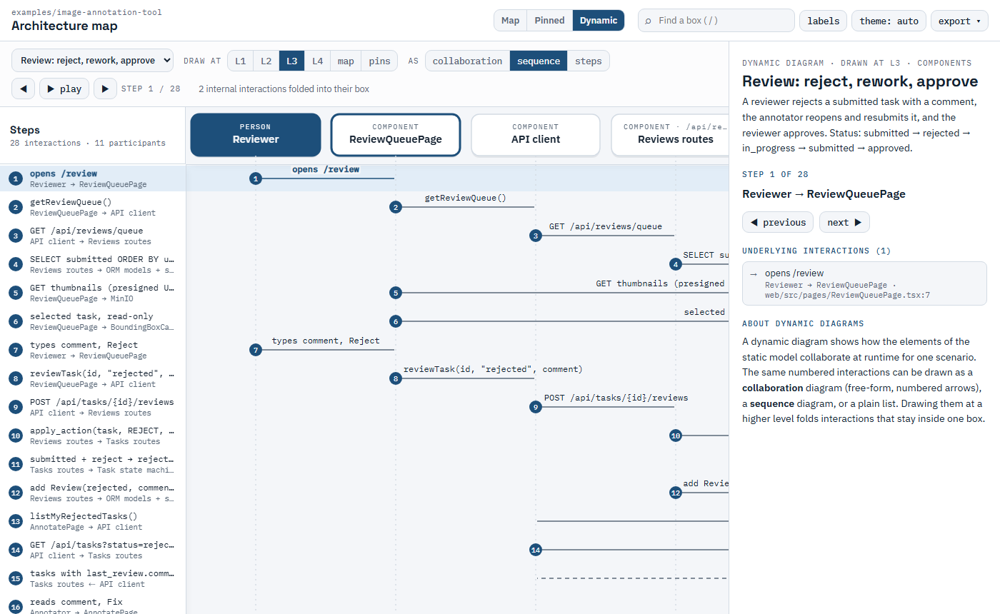

# Architecture explorer

One HTML file that lets a reader drill from the system context down to the code, C4 style. Everything
project-specific is one data block, `window.MODEL`, holding nodes, relationships, scenarios and state machines. The
rendering engine around it never changes, so a page can be rebuilt with a newer template at any time.

[:octicons-arrow-right-24: Open the live example](example/explorer.md){ .md-button .md-button--primary }

{ .shot }

## What readers can do

### Map

Boxes open in place: from the system context (L1) to containers (L2), components (L3) and code (L4). A box with
children shows a **+ N inside** badge; double-click it or press the badge to open it, and the boxes around it make
room. Keys ++1++ to ++4++ open the whole map to a level. Pan, zoom, a minimap and search (++"/"++) help on large
models; the minimap's `–` button (or ++o++) minimizes it to a small chip.

Relationships are declared once, between the most specific elements known, and drawn between whatever is visible.
A closed container therefore shows every relationship of the things inside it. Arrows are **squared** by default,
running in the gaps between boxes on separate lanes; ++e++ switches to **straight** arrows that bend around boxes.

### Details panel

Click a box to see its description, notes, technology, source file and line (linked to the repository), the boxes
inside it, and the lists of what it uses and what uses it. Every entry navigates to the other end.

The handle on the right edge of the map (or ++i++) folds the panel away and gives the views the whole width; it
stays folded when you select a box (the handle shows a dot) until you bring it back. On a phone the panel is a bottom
sheet that folds to one line. Both the panel and the minimap remember their state and appear in the URL
(`#panel=closed`, `#mm=min`).

### State machines

A lifecycle (task statuses, order states) is drawn as states and transitions inside the box that owns it, with
the initial and final states marked.

{ .shot }

### Scenarios

The **Dynamic** tab (++d++) shows one runtime flow at a time, step by step, as a collaboration diagram, a sequence
diagram or a table. Draw it at any level: steps that stay inside one box are folded away. Step through with
++left++ ++right++, or play it with ++space++. **☰ all scenarios** (++s++) lists every scenario with a short
explanation, the elements it passes through and its length.

{ .shot }

### Sequence inside a box

On the map, an open box that a scenario passes through gets a **⇅ sequence** button. Its inside becomes a sequence
diagram of that scenario: its own parts as lifelines, and the outside elements it talks to as dashed cards at the
edges (callers on the left, what it calls on the right). Switch scenario with **‹ ›**, play it with **▶ play**,
click a message for the code behind it, or select a part and show its own sequence to go one level deeper.

{ .shot }

### Pinned board, variants, themes

- **Pinned board** (++b++): pin any boxes from any level (++p++) and see only them and the relationships between
  them, one lane per level.
- **Variants**: when parts of the architecture exist only in some configurations (cloud or on-premises, a feature
  flag), a filter fades what a variant does not use.
- **Colour themes** (++t++ or the `theme ▾` menu): light and dark following the operating system by default, plus
  contrast, paper, blueprint and graphite.
- **Sizes** (`size ▾`): make the toolbars and panel smaller, spread the boxes further apart without making them
  bigger, or make the arrow labels and arrows smaller or larger. Remembered per browser.
- **Links to any view**: the URL hash records what is open and selected, the scenario and step, and the theme, so
  any view can be shared, reloaded or screenshotted.

### Export a diagram

`export ▾` → **This view** saves the diagram on screen as an **SVG**, a **PNG** or an **HTML** page of its own: the
whole map (not only the part in the window), the Pinned board, or the scenario's collaboration or sequence diagram,
in the colours on screen. `export ▾` → **The model** downloads the architecture as an RDF graph (see
[RDF export](rdf.md)).

### Edit the model in the page

`✎ edit` turns the page into an editor of its own model, with an edit bar under the toolbar and a form in the panel.

- **Add** a box by dragging a type from the edit bar onto the map (into an open box or at the top level), or click a
  type to add one inside the selected box.
- **Move** a box by dragging it: onto a sibling to swap places, into a gap for a new row or column, or into another
  open box to put it inside.
- **Connect** two boxes with Alt+drag from one to the other, or `→ connect to…` and a click.
- **Edit** anything in the panel: name, id (references follow), type, description, notes, technology, source path
  and line, colour, the box it is inside, each connection's label and style; with nothing selected, the project,
  source links, RDF base and vocabulary, the opening view and every scenario step. Each box also shows its RDF
  triples.
- **Delete** with the button or the Delete key; undo and redo with Ctrl+Z and Ctrl+Y.

Every change is checked by the page's validator before it is made. The edits stay in the browser until you
download them: `model.js` to rebuild from, the whole `page` with the new model inside, or the graph as JSON-LD,
Turtle (`.ttl`) or `.rete`. Try it on the [live example](example/explorer.md).

### Versions and compare mode

Built with the history of its model (`--history`, from the `architecture-history` skill), the page gets a history
bar along the bottom of the map: step through the versions or play them, and compare two, with added boxes and arrows
in green, removed ones as red ghosts and changed ones in amber, each change listed with who made it and when.
**History** (or ++h++) opens a list of every version with its message, authors, pull request and changes; click a
change to go to it. See [History and diffs](history.md).

### Keyboard

| Key | Action |
|---|---|
| ++1++ to ++4++ | Open the map to that level |
| ++"/"++ | Search |
| ++f++, ++"+"++, ++"-"++ | Fit, zoom in, zoom out |
| ++m++, ++b++, ++d++ | Map, Pinned board, Dynamic |
| ++p++ | Pin or unpin the selected box |
| ++s++ | Sequence inside the selected box, or its boxes again (Map) · all scenarios (Dynamic) |
| ++l++, ++e++, ++t++ | Arrow labels, arrow style, colour theme |
| ++i++, ++o++ | Hide or show the details panel, minimize or restore the minimap |
| ++bracket-left++ ++bracket-right++, ++c++, ++h++ | With a history: previous / next version, compare, the version list |
| ++esc++ | Clear the selection (or close the version list) |
| ++left++ ++right++ ++space++ | Previous step, next step, play |
| ++del++, ++ctrl+z++, ++ctrl+y++ | In edit mode: delete the selected box, undo, redo |

## How the page is built

```
communications/architecture-explorer/
  model.js              window.MODEL = { project, nodes, edges, scenarios, ... };
  index.html            the template with model.js pasted between /* BEGIN MODEL */ and /* END MODEL */
  architecture.jsonld   the same model as an RDF graph
```

A minimal model:

```js
window.MODEL = {
  project: { name: 'Shoply', subtitle: 'acme/shoply', intro: 'Online shop backend. Start at the API service.' },
  nodes: [
    { id: 'shopper', type: 'person', name: 'Shopper', desc: 'Buys things through the web shop.' },
    { id: 'shoply', type: 'system', name: 'Shoply', desc: 'Takes orders and charges customers.' },
    { id: 'api', parent: 'shoply', type: 'container', name: 'API service', path: 'api/', desc: 'Only entry point.' },
    { id: 'db', parent: 'shoply', type: 'store', name: 'Orders DB', desc: 'System of record.' }
  ],
  edges: [
    { from: 'shopper', to: 'api', label: 'POST /orders', kind: 'accent' },
    { from: 'api', to: 'db', label: 'INSERT order' }
  ],
  scenarios: [
    { id: 'checkout', name: 'Checkout', desc: 'A shopper pays for a basket.', steps: [
      { from: 'shopper', to: 'api', label: 'POST /orders' },
      { from: 'api', to: 'db', label: 'INSERT' },
      { from: 'api', to: 'shopper', label: '201 · order id', reply: true }
    ] }
  ]
};
```

The full schema is in the [data model reference](reference/explorer-data-model.md), and the
[features reference](reference/explorer-features.md) covers layout, URL parameters, switching features off, and
how to make a good diagram (what the levels mean, how many boxes, naming, edges, scenarios).

### Build and check

```sh
node <plugin>/skills/architecture-explorer/scripts/build-explorer.mjs \
  communications/architecture-explorer/model.js \
  communications/architecture-explorer/index.html --root .
```

The build copies the template, inserts the model and runs `check-model.mjs`:

- schema errors (unknown ids, duplicates, overlapping positions) and warnings (text that will not fit, missing
  descriptions, crowded groups);
- with `--root`, every `path` exists and every `line` is inside its file;
- a layout report per group of boxes: arrows that bend around a box, cross, or still pass behind one.

`scripts/screenshot.mjs` captures any view with headless Chrome or Edge, using the URL hash:

```sh
node <plugin>/skills/architecture-explorer/scripts/screenshot.mjs index.html shots \
  "level=2" "open=api&zoom=api" "view=dynamic&scenario=checkout&style=seq&at=3" \
  "level=2&seq=api:checkout&zoom=api"
```

The model also exports as an RDF graph; see [RDF export](rdf.md).
