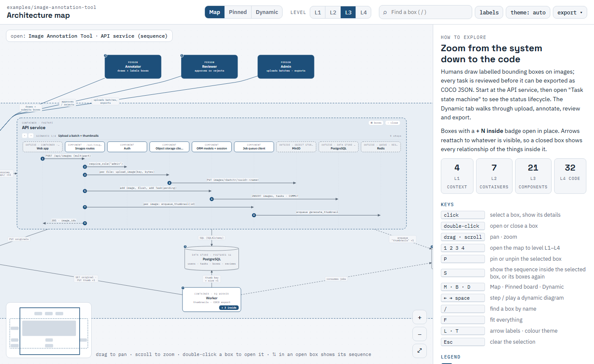

# Architecture explorer

One HTML file that lets a reader drill from the system context down to the code, C4 style. Everything
project-specific is one data block, `window.MODEL`, holding nodes, relationships, scenarios and state machines. The
rendering engine around it never changes, so a page can be rebuilt with a newer template at any time.

[:octicons-arrow-right-24: Open the live example](example/explorer.md){ .md-button .md-button--primary }

{ .shot }

## What readers can do

### Map

Boxes open in place: from the system context (L1) to containers (L2), components (L3) and code (L4). A box with
children shows a **+ N inside** badge; double-click it or press the badge to open it, and the boxes around it make
room. Keys ++1++ to ++4++ open the whole map to a level. Pan, zoom, a minimap and search (++"/"++) help on large
models.

Relationships are declared once, between the most specific elements known, and drawn between whatever is visible.
A closed container therefore shows every relationship of the things inside it. Arrows are **squared** by default,
running in the gaps between boxes on separate lanes; ++e++ switches to **straight** arrows that bend around boxes.

### Details panel

Click a box to see its description, notes, technology, source file and line (linked to the repository), the boxes
inside it, and the lists of what it uses and what uses it. Every entry navigates to the other end.

### State machines

A lifecycle (task statuses, order states) is drawn as states and transitions inside the box that owns it, with
the initial and final states marked.

{ .shot }

### Scenarios

The **Dynamic** tab (++d++) shows one runtime flow at a time, step by step, as a collaboration diagram, a sequence
diagram or a table. Draw it at any level: steps that stay inside one box are folded away. Step through with
++left++ ++right++, or play it with ++space++. **☰ all scenarios** (++s++) lists every scenario with a short
explanation, the elements it passes through and its length.

{ .shot }

### Sequence inside a box

On the map, an open box that a scenario passes through gets a **⇅ sequence** button. Its inside becomes a sequence
diagram of that scenario: its own parts as lifelines, and the outside elements it talks to as dashed cards at the
edges (callers on the left, what it calls on the right). Switch scenario with **‹ ›**, play it with **▶ play**,
click a message for the code behind it, or select a part and show its own sequence to go one level deeper.

{ .shot }

### Pinned board, variants, themes

- **Pinned board** (++b++): pin any boxes from any level (++p++) and see only them and the relationships between
  them, one lane per level.
- **Variants**: when parts of the architecture exist only in some configurations (cloud or on-premises, a feature
  flag), a filter fades what a variant does not use.
- **Light and dark themes** (++t++), following the operating system by default.
- **Links to any view**: the URL hash records what is open and selected, the scenario and step, and the theme, so
  any view can be shared, reloaded or screenshotted.

### Keyboard

| Key | Action |
|---|---|
| ++1++ to ++4++ | Open the map to that level |
| ++"/"++ | Search |
| ++f++, ++"+"++, ++"-"++ | Fit, zoom in, zoom out |
| ++m++, ++b++, ++d++ | Map, Pinned board, Dynamic |
| ++p++ | Pin or unpin the selected box |
| ++s++ | Sequence inside the selected box, or its boxes again (Map) · all scenarios (Dynamic) |
| ++l++, ++e++, ++t++ | Arrow labels, arrow style, colour theme |
| ++esc++ | Clear the selection |
| ++left++ ++right++ ++space++ | Previous step, next step, play |

## How the page is built

```
communications/architecture-explorer/
  model.js              window.MODEL = { project, nodes, edges, scenarios, ... };
  index.html            the template with model.js pasted between /* BEGIN MODEL */ and /* END MODEL */
  architecture.jsonld   the same model as an RDF graph
```

A minimal model:

```js
window.MODEL = {
  project: { name: 'Shoply', subtitle: 'acme/shoply', intro: 'Online shop backend. Start at the API service.' },
  nodes: [
    { id: 'shopper', type: 'person', name: 'Shopper', desc: 'Buys things through the web shop.' },
    { id: 'shoply', type: 'system', name: 'Shoply', desc: 'Takes orders and charges customers.' },
    { id: 'api', parent: 'shoply', type: 'container', name: 'API service', path: 'api/', desc: 'Only entry point.' },
    { id: 'db', parent: 'shoply', type: 'store', name: 'Orders DB', desc: 'System of record.' }
  ],
  edges: [
    { from: 'shopper', to: 'api', label: 'POST /orders', kind: 'accent' },
    { from: 'api', to: 'db', label: 'INSERT order' }
  ],
  scenarios: [
    { id: 'checkout', name: 'Checkout', desc: 'A shopper pays for a basket.', steps: [
      { from: 'shopper', to: 'api', label: 'POST /orders' },
      { from: 'api', to: 'db', label: 'INSERT' },
      { from: 'api', to: 'shopper', label: '201 · order id', reply: true }
    ] }
  ]
};
```

The full schema is in the [data model reference](reference/explorer-data-model.md), and the
[features reference](reference/explorer-features.md) covers layout, URL parameters, switching features off, and
how to make a good diagram (what the levels mean, how many boxes, naming, edges, scenarios).

### Build and check

```sh
node <plugin>/skills/architecture-explorer/scripts/build-explorer.mjs \
  communications/architecture-explorer/model.js \
  communications/architecture-explorer/index.html --root .
```

The build copies the template, inserts the model and runs `check-model.mjs`:

- schema errors (unknown ids, duplicates, overlapping positions) and warnings (text that will not fit, missing
  descriptions, crowded groups);
- with `--root`, every `path` exists and every `line` is inside its file;
- a layout report per group of boxes: arrows that bend around a box, cross, or still pass behind one.

`scripts/screenshot.mjs` captures any view with headless Chrome or Edge, using the URL hash:

```sh
node <plugin>/skills/architecture-explorer/scripts/screenshot.mjs index.html shots \
  "level=2" "open=api&zoom=api" "view=dynamic&scenario=checkout&style=seq&at=3" \
  "level=2&seq=api:checkout&zoom=api"
```

The model also exports as an RDF graph; see [RDF export](rdf.md).
