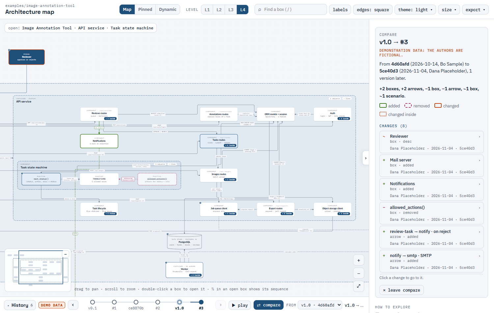
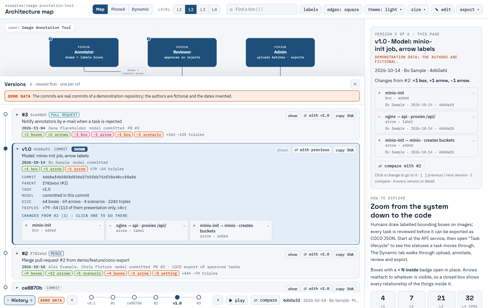

# History and diffs

An explorer model committed with the code has a history. The `architecture-history` skill reads it with git and
turns it into **versions with provenance**: which architecture each commit, merge, release or pull request held, who
changed what and when, and what changed between any two versions, from boxes and arrows down to single RDF triples.
The explorer page gets a **history bar** to step through the versions, a **version list** with the details of each
one, and a **compare mode** that draws the differences.

{ .shot }

*Compare mode on demonstration data (fictional authors): a pull request adds a mail server and a notification
component (green) and drops a helper function from the model (red ghost); the panel lists every change with who and
when, and a click on one goes to it.*

## Try it

```text
> /c4-model-agentic-plugin:architecture-history
> /c4-model-agentic-plugin:architecture-history timeline tags
> /c4-model-agentic-plugin:architecture-history diff main feature/payments
> /c4-model-agentic-plugin:architecture-history pr 42
```

Claude shows what the history holds, agrees with you on the source and the resolution, regenerates models that are
missing or out of date (outside your checkout), builds and validates the dataset, rebuilds the explorer with the
history in it, and reports. The command line underneath works on its own too (Node 18+, git, and gh for pull requests):

```sh
node skills/architecture-history/scripts/arch-history.mjs timeline --resolution merges
node skills/architecture-history/scripts/arch-history.mjs diff v1.0 main
node skills/architecture-history/scripts/arch-history.mjs pr 42
node skills/architecture-history/scripts/arch-history.mjs blame v2.0
node skills/architecture-history/scripts/arch-history.mjs status
```

## In the explorer

```sh
node skills/architecture-explorer/scripts/build-explorer.mjs \
  communications/architecture-explorer/model.js communications/architecture-explorer/index.html \
  --root . --history communications/architecture-history/history.json
```

{ .shot }

*The version list on demonstration data (fictional authors and invented dates, as its banner says).*

- **History bar**: along the bottom of the map, the Pinned board and the Dynamic view, like a bottom navigation bar;
  one dot per version, labelled with its tag or pull request. Click a dot, step with `‹ ›` or the `[` and `]` keys,
  or press play. The page runs again on that version's model, keeping your zoom and the boxes you opened. The panel
  says who made the version, when, and what it changed. The bar never covers the minimap, the zoom buttons or the
  panel; with the panel folded away it spans the whole width, and on a phone it sits above the bottom sheet.
- **Version list**: **▴ History** (or `H`) opens a drawer with every version, newest first, the one shown highlighted.
  Each card has the tag, pull request or short SHA, the kind (commit, merge, tag, pull request, squash), the date, the
  authors, the first line of the commit message, the pull request, whether the model was committed or regenerated, and
  what changed since the version before (`+` / `−` / `~` boxes, arrows, scenarios, and the RDF triples added and
  removed). Unfold a card for the full message, the SHA, parents, branches, the pull request's branches and the list
  of changes. Each card can be **shown**, **compared** with the version on screen (or set as end A or B of a
  comparison), its **SHA copied**, and its **commit** or **pull request** opened on GitHub, GitLab or Bitbucket when
  the repository is known. `Esc` closes it; `#hist=open` in the URL opens it.
- **Compare mode** (`⇄ compare` or `C`): the later version is drawn with **added** boxes and arrows in green,
  **removed** ones brought back from the earlier version as red, dashed ghosts, and **changed** ones in amber. A closed
  box with changes inside gets a dotted amber border. Click a dot to move the later end, Shift + click (or the *from*
  list) to move the earlier one. The panel lists every change with the fields that changed and who changed them in
  which commit; select a box to see its old and new text.
- **Go to a change**: every change in the panel and in the version list is a button. A box is opened down to its
  level, selected and centred; an arrow shows both ends, selected, with the arrow highlighted; a removed box or arrow
  is its red ghost; a scenario opens the Dynamic view on the step that changed. A change of another version switches
  to that version first (or to a comparison with the version before it, for a removal or when you are comparing).
- **Links**: `#ver=<key>` opens a version, `#ver=<key>&cmp=<key>` a comparison, `#hist=open&hx=<key>` the version
  list with that card unfolded, together with the usual state (`open=`, `level=`, `sel=` …). The colours come from
  each theme's tones.
- You edit the page's own model only: **✎ edit** is hidden while an older version or a comparison is shown.

## What to build the history from

| Resolution | One version per | For |
|---|---|---|
| `merges` (default) | merge or direct commit on the first-parent line of a branch | how `main` evolved |
| `all` | commit that changed the model, branch commits included | the full detail |
| `tags` | release tag (unchanged releases are skipped) | release notes |
| `prs` | merged pull request (gh, or GitHub's merge messages) | review history |
| `--refs a,b,c`, `--pr N` | named ref or pull request | side by side |

`--range A..B` limits any of them; `--range A..B --squash` turns a release into one step that lists the commits it
covers. `--worktree` adds your uncommitted model. Within a merge, a release or a squash, each change still names the
commit inside it that made it, so a merge is credited to the branch's authors as well as the person who merged it.

## Refs with no model, or an outdated one

A commit may have no `model.js`, or code that changed after its model was last updated. `status` (and every other
command) lists those refs with each changed file and the boxes whose `path` covers it. The skill regenerates such a
model **incrementally and outside your checkout**: `prepare` makes a git worktree in the temp directory with a copy of
the last model, Claude updates only the boxes, arrows and scenario steps the changed files touch, and `adopt` checks the
result against that commit's files with `check-model.mjs --root <worktree>`, keeps it, and removes the worktree. The
version is then marked `c4h:Regenerated` and credited to whoever regenerated it, never to the commit's author.

## The dataset

Every version is a **named graph** holding the whole architecture in the [ontology's](ontology/index.md) core and
view terms, exactly what the explorer exports for that model. The default graph describes the versions with
[PROV-O](https://www.w3.org/TR/prov-o/) and the [history terms](ontology/c4-history.md): the previous version, when, the
commit, merge, release or pull request that produced it, the people it is attributed to, and the git details. Between
consecutive versions, a **changeset** graph describes each added or removed triple with an **RDF 1.2 reifier**:

```turtle
:change:3f2a… rdf:reifies <<( :worker rdfs:label "Worker" )>> ;
    a c4h:Addition ;
    c4h:changedIn :version:5fe7797… ;          # the merge that brought it into main
    prov:wasGeneratedBy :commit:981064d… ;     # the commit on the branch that wrote it
    prov:wasAttributedTo :agent:bo-sample ;
    prov:generatedAtTime "2026-09-15T10:05:00Z"^^xsd:dateTime .
```

Next to them, one element change per box, state, arrow, transition or scenario summarises the same change for people
(added, removed, or modified with the fields that changed). `blame` links every triple of one version to the version
and author that introduced it. The files: `history.trig` (TriG 1.2), `history.nq`, `history.rete` (one queryable file
with its named graphs, via [rete](https://github.com/caviri/rete)), `history.json` for the page, and Markdown reports
(`timeline.md`, `diff-…md`, `pr-…md`, `blame-…md`). Shapes in `ontology/c4-history-shapes.ttl` check every dataset.

Who added the Worker box, and when:

```sparql
PREFIX prov: <http://www.w3.org/ns/prov#>
PREFIX foaf: <http://xmlns.com/foaf/0.1/>
PREFIX rdf:  <http://www.w3.org/1999/02/22-rdf-syntax-ns#>
PREFIX rdfs: <http://www.w3.org/2000/01/rdf-schema#>
SELECT ?who ?when ?commit WHERE {
  GRAPH ?cs { ?r rdf:reifies <<( <urn:architecture:image-annotation-tool:worker> rdfs:label "Worker" )>> ;
                 prov:wasAttributedTo ?a ; prov:generatedAtTime ?when ; prov:wasGeneratedBy ?commit }
  ?a foaf:name ?who .
}
```

The [history graph guide](reference/history-graph.md) has the layout, the stable IRIs, more tested queries and the
validation; the [workflows guide](reference/history-workflows.md) has the four workflows and the command reference.

## Names, not e-mail addresses

Datasets carry each author's **name** only. Commit e-mail addresses are personal data: anyone with the repository can
read them, but a dataset copies them to new places (a published page, a shared `.rete` file) and makes them easy to
harvest. `--emails` adds them when you want them, and the dataset says which it is (`c4h:includesEmails`). The same
goes for addresses inside commit messages (`Signed-off-by:`, `Co-authored-by:` trailers): they are dropped from the
messages the dataset and the page carry. Credentials in a remote URL are never exported.

## Real history and demonstration data

The example in this repository is real: its model has two committed versions (the first model, then use-case fields on
two scenarios), and the published explorer has that history embedded. To show merges, pull requests, releases, a
stale model and a branch comparison, `skills/architecture-history/scripts/make-demo-history.mjs` replays a made-up
evolution of the same project into a new repository, with fictional authors and invented dates. A history built from
it with `--demo` says so in the dataset (`c4h:demo`, `c4h:fictional`), the reports and the page. The screenshots on
this page come from that demonstration repository.
