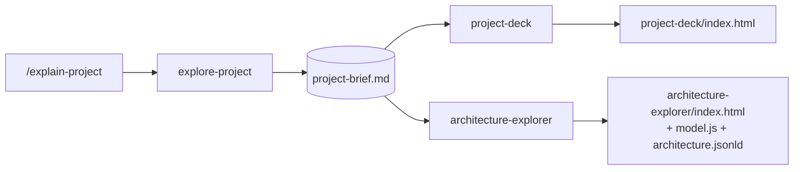

# How it works

The plugin is one command and three skills. The command decides what to produce; the skills do the work, and each
one is a set of instructions, templates and scripts that Claude follows.

## 1. Explore: `explore-project`

The goal is a **project brief**: a compact model of the system, with a file reference for every element. Claude
works outside in and stops reading as soon as a question is answered:

1. **Orient.** README, docs, then deployment files (`docker-compose`, Dockerfiles, Kubernetes, Terraform, CI),
   which are the most reliable source for containers. Then manifests and the top of the directory tree.
2. **Ask.** One round of questions, each with a recommended default: audience, scope, outputs, emphasis, and
   "what did I get wrong?" about its summary. See the [question bank](reference/explore-questions.md).
3. **Map the structure, C4 style.** People and external systems (L1), separately deployed units and stores (L2),
   and the modules inside the containers that matter (L3). Every relationship gets a verb and a protocol.
4. **Trace the flows.** Two to five flows end to end through real code, plus any state machine.
5. **Write the brief** from the [template](reference/explore-brief-template.md), and ask for corrections before
   generating anything.

Rules it follows: evidence over plausibility, uncertainty marked as "inferred", the project's own vocabulary, and no
opinions about the architecture unless you ask for them. The [playbook](reference/explore-playbook.md) covers
where to look per stack, and how to handle monorepos, libraries, CLIs and data pipelines.

The brief from the example is [here](example/brief.md).

## 2. Generate: `project-deck` and `architecture-explorer`

Once the brief exists the two outputs are independent, so Claude can build them in parallel.

**The deck.** Claude writes an outline first (chapters, slide pattern, headline sentence and the source of each
fact), then copies the slide patterns it needs from the template, draws figures with a small Python SVG library,
and builds one HTML file. See [Project deck](deck.md).

**The explorer.** Claude writes the architecture as one data block, `window.MODEL`: nodes, relationships,
scenarios and state machines. The build script puts it into the explorer template and validates it. See
[Architecture explorer](explorer.md).

## 3. Check

Neither output is reported as done until Claude has looked at it:

- the explorer build checks the model, every source path and line number, and the layout (arrows that bend around
  boxes, cross, or pass behind them);
- the deck build reports text that does not fit, arrows through boxes and labels that overrun;
- both are opened in headless Chrome or Edge and screenshotted at the states that matter, and Claude reads the
  screenshots.

Anything it could not verify is listed in its final report.
