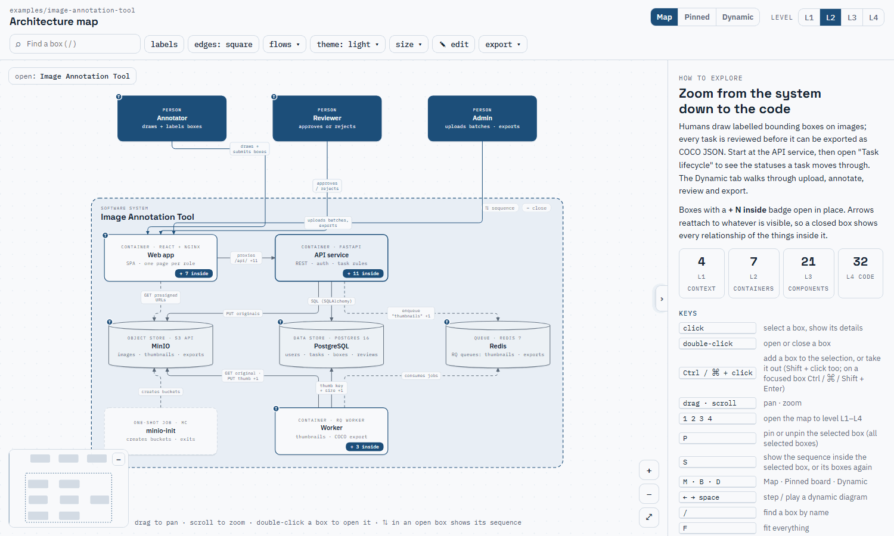
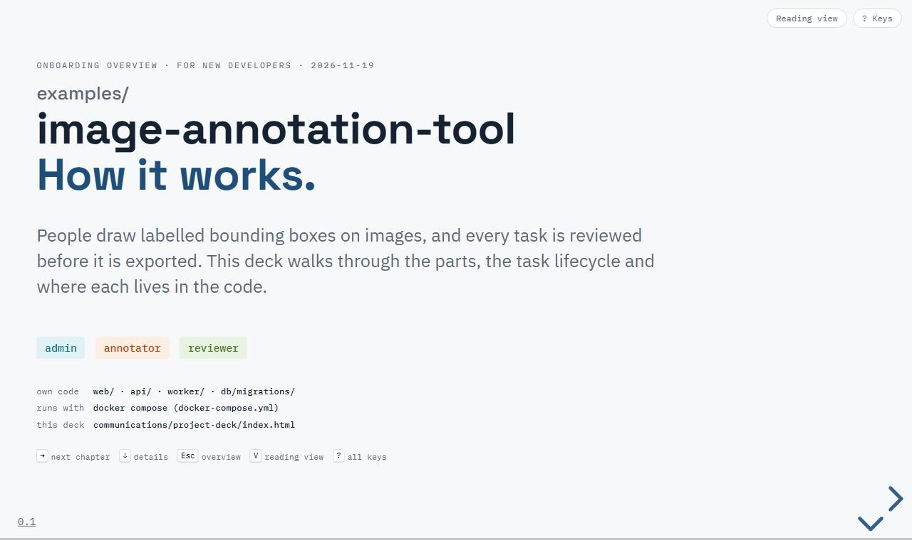

# Explain any codebase as a deck and a C4 architecture map

<p class="hero-lead">
c4-model-agentic-plugin is a Claude Code plugin. Point it at a repository and it reads the code, asks you a few
questions, and writes two self-contained HTML pages: a slide deck that explains what the project is about, and an
interactive C4 architecture explorer you can drill from the system context down to the code. Every box, arrow and
step points back to a file.
</p>

[Get started](getting-started.md){ .md-button .md-button--primary }
[See the example](example/index.md){ .md-button }

<div class="grid cards" markdown>

-   :material-sitemap-outline: **Architecture explorer**

    ---

    [](example/explorer.md)

    Boxes that open in place from L1 to L4, scenarios as collaboration and sequence diagrams (also drawn inside a
    container on the map), state machines, a pinned board, search, light and dark themes, and an RDF export.

    [:octicons-arrow-right-24: Try the live example](example/explorer.md) · [Guide](explorer.md)

-   :material-presentation: **Project deck**

    ---

    [](example/deck.md)

    A reveal.js deck with C4 slides that zoom into each other, step-through and sequence diagrams drawn as SVG,
    highlighted code, speaker notes and a reading view.

    [:octicons-arrow-right-24: Flip through the example](example/deck.md) · [Guide](deck.md)

</div>

## Install

In Claude Code:

```
/plugin marketplace add caviri/c4-model-agentic-plugin
/plugin install c4-model-agentic-plugin@c4-model-agentic-plugin
```

Then, in the project you want explained:

```
/c4-model-agentic-plugin:explain-project
```

See [Getting started](getting-started.md) for requirements, options and where the output goes.

## How it works

1. **Explore.** Claude reads the repository from the outside in: README, deployment files, manifests,
   entrypoints, then the main flows.
2. **Ask.** It asks a few scoping questions (audience, scope, which flows matter) and lets you correct its summary
   and container list.
3. **Brief.** It writes `communications/project-brief.md`: actors, external systems, containers, components,
   relationships, state machines and flows, each with a file reference.
4. **Generate.** It builds the deck and the explorer from the brief, then opens them in a headless browser to check
   them.

More in [How it works](how-it-works.md).

## Single files, no server

Each output is one HTML file. Open it from disk, attach it to a message, or publish the folder on any static host,
GitHub Pages included. Readers need no server and no build step.
