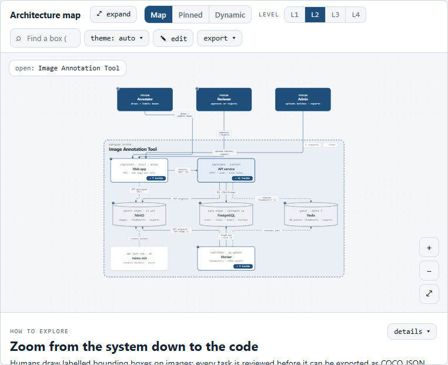

# ChatGPT and Claude (MCP)

The plugin's explorer also works **without Claude Code**. A remote [MCP](https://modelcontextprotocol.io/) server
gives ChatGPT, Claude (web and desktop) or any MCP client the same method and the same checks: the assistant explores
a public GitHub repository, writes the architecture model, validates it against the explorer's own validator and the
ontology's SHACL shapes, exports it as RDF, and **draws the explorer inline in the chat** as an
[MCP Apps](https://modelcontextprotocol.io/extensions/apps/overview) view.

{ .shot }

*The view in a test host that speaks the MCP Apps protocol (ext-apps AppBridge, sandbox proxy, the spec's CSP).
In ChatGPT and Claude it appears under the assistant's message; ⤢ expand opens it full screen or in Claude's side panel.*

The server lives in [`mcp/`](https://github.com/caviri/c4-model-agentic-plugin/tree/main/mcp) and reads the
explorer template, its references and the ontology from the repository at startup, so the chat version and the
plugin cannot drift apart. It is **stateless**: every call carries the whole model, and nothing about it is stored.

## Connect it

You need the URL of a running server, such as `https://<your-space>.hf.space/mcp` (see [Host it](#host-it)).

=== "Claude (web, desktop)"

    1. **Customize → Connectors → Add → Add custom connector** (on Team and Enterprise plans an Owner adds it under
       **Organization settings → Connectors**).
    2. Name it, paste the server URL ending in `/mcp`, choose **No sign-in** (unless you set `MCP_BEARER_TOKEN`),
       then **Add**.
    3. In a chat, turn the connector on from the **+** menu → **Connectors**.

    Custom connectors work on Free (one connector), Pro, Max, Team and Enterprise plans. Interactive views render on
    Claude's web and desktop apps.

=== "ChatGPT"

    1. Open **chatgpt.com/plugins**, click **+**, then **Add custom MCP server**.
    2. Give it a name and a description, enter the server URL including `/mcp`, choose no authentication (unless you
       set `MCP_BEARER_TOKEN`), and **Create as a plugin**.
    3. Review the tools ChatGPT found. After a server update, open the plugin and **Refresh**.

    Whether you can add custom servers depends on your plan and workspace settings (an administrator may have to allow
    them, or developer mode may need to be on).

=== "Claude Code, Claude Desktop, other clients"

    Remote: `claude mcp add --transport http c4-explorer https://<your-server>/mcp`

    Local, without hosting anything (stdio):

    ```sh
    cd mcp && npm ci
    claude mcp add c4-explorer -- node "$PWD/server.mjs" --stdio
    ```

    The [MCP Inspector](https://modelcontextprotocol.io/docs/tools/inspector) connects the same ways.

Then ask, for example:

```text
Map the architecture of github.com/owner/repo as a C4 explorer. I'm onboarding a new backend developer.
```

The connector also offers this as a prompt (`explore_github_repository`), plus `model_from_description` for a system
you describe in the chat instead of a repository.

## What the assistant does

1. `get_method` once: the exploration method (adapted from the `explore-project` skill for a chat without a shell),
   the MODEL schema ([data model](reference/explorer-data-model.md)) and a summary of the [ontology](ontology/index.md).
2. Explores with `github_tree`, `github_read_file` and `github_search`, asks you its questions once, and writes the
   model from evidence, citing paths and lines.
3. `validate_model` with the repository until there are no errors: the explorer's validator, SHACL on the RDF graph,
   the layout check (arrows behind boxes), and every `path` and `line` checked against GitHub.
4. `show_explorer`: the explorer, in the chat.
5. On request: `export_rdf` (Turtle, JSON-LD, N-Triples, `.rete`), `build_explorer_page` (the standalone
   `index.html`), `query_sparql` over the graph.

## Tools

| Tool | Does |
|---|---|
| `get_method` | Method, MODEL schema, ontology summary (`part`: method, schema, ontology, all). |
| `github_tree` | Files of a public repository at a ref, to a depth; vendored and generated folders collapsed. |
| `github_read_file` | A file or a line range, with line numbers (up to 1,000 lines a call). |
| `github_search` | Paths and contents of up to 200 small text files per call, substring or regex. |
| `validate_model` | Validator, SHACL, layout, and (with `repo`, `root`) paths and lines against GitHub. |
| `export_rdf` | `ttl`, `jsonld`, `nt` as text; `rete` as an embedded binary resource. |
| `model_from_rdf` | A graph (`nt`, `ttl`, `jsonld`, or `.rete` as base64) back to the MODEL. |
| `show_explorer` | The interactive view; `view` picks the level, open boxes, selection, tab, scenario, style, theme; `history` adds the timeline. |
| `build_explorer_page` | The standalone page as an embedded `text/html` resource (about 400 KB). |
| `list_elements`, `get_element`, `query_sparql` | The explorer's own [agent tools](#webmcp-agents-in-the-browser) that read a model, with the model as an argument. |

Resources: the method, `data-model.md`, `rdf-graph.md`, `features.md`, the explore-project skill files, `c4.ttl`,
`c4-view.ttl`, `c4-shapes.ttl`, `EXTENDING.md`, a generated ontology summary and the example model, for clients that
attach resources.

## The view

The view is the explorer page itself (`ui://c4-explorer/explorer.html`, `text/html;profile=mcp-app`), generated
from the template at startup: the web fonts are removed, a small bridge script is added after the engine, and the
model arrives with the tool call. Nothing in it touches the network, so its declared
[Content Security Policy](https://apps.extensions.modelcontextprotocol.io/api/documents/csp-cors.html) lists no
domains at all.

- **Drawing.** The bridge uses the official `App` class of `@modelcontextprotocol/ext-apps` (protocol `2026-01-26`).
  On `ui/notifications/tool-input` and `tool-result` it restarts the engine with the model, exactly as the page's
  own editor does (`ARCH_EXPLORER.teardown()`, then `archEngine()`), then applies `view`.
- **Size.** Inline it asks for 620 px (less if the host caps it) and reports it with `ui/notifications/size-changed`;
  a compact toolbar keeps the map large and the details sheet starts folded. **⤢ expand** requests full screen
  (`ui/request-display-mode`); there the view fills what the host gives it.
- **Downloads.** Chat apps block downloads from their frames, so every export of the page (SVG, PNG, HTML, JSON-LD,
  Turtle, the editor's `model.js` and page) goes through the host's download dialog (`ui/download-file`). A `.rete`
  file is built by the server (`export_rdf`, called from the view) instead of fetching the builder from a CDN.
  `model.js` is saved as `model.js.txt`, because Claude refuses `.js` downloads.
- **Links** to the source open through the host (`ui/open-link`); the host's light or dark theme is followed while the
  reader's theme is `auto`.
- **Agents.** The view also offers the explorer's [agent tools](#webmcp-agents-in-the-browser) to the chat's
  assistant as MCP Apps *app tools*, so it can open a level, select boxes or show a scenario in the view you have open.
  Claude offers app tools to a limited set of organizations so far.
- **History.** With `history` (a `history.json` from the [history skill](history.md)) the view shows the timeline
  and compare mode; without it the bar stays hidden.

Where a chat has no MCP Apps support, `show_explorer` still answers with a text summary and points to
`build_explorer_page` and `export_rdf`.

## Privacy and security

- **Stateless.** Models, graphs and histories exist only for the duration of a call. The server logs the tool name,
  the outcome and the time it took, never arguments.
- **GitHub.** Only `api.github.com` (repository metadata, file trees) and `raw.githubusercontent.com` (file contents)
  are contacted, only when the assistant calls a GitHub tool or `validate_model` with `repo`. Public repositories
  only; private ones are refused even if the server's token could read them. Fetched files are cached in memory for
  ten minutes (48 MB at most).
- **Untrusted content.** Repository files can contain text written to steer an AI. The GitHub tools say so in their
  descriptions and mark their output as untrusted data; the agent tools that return page text carry the same
  caution and WebMCP's `untrustedContentHint`.
- **The view** runs in the chat's sandboxed frame with a CSP that allows no external origin, and asks for no camera,
  microphone, location or clipboard.
- A public server has no sign-in by default. Set `MCP_BEARER_TOKEN` to require a token (supported by clients that send
  custom headers), and keep the per-client rate limit on.

## Limits

| What | Limit |
|---|---|
| Model (any tool) | 1.5 M characters of JSON; 1,500 boxes, 4,000 arrows, 60 scenarios |
| Model inside the `show_explorer` result | 100 K characters (larger models reach the view through the tool arguments) |
| RDF input to `model_from_rdf` | 4 M characters |
| `github_read_file` | 1 MB per file, 1,000 lines or 100 K characters per call |
| `github_search` | 200 files of up to 512 KB per call, 200 results |
| `query_sparql` | 10 s, 500 rows |
| HTTP | 6 MB per request, 120 requests per minute per client (configurable) |

Claude passes a tool result inline up to about 150,000 characters; above that (with code execution on) it stores the
result as a file, and a view would not receive it. `show_explorer` stays well under that for models of a few hundred
boxes. `build_explorer_page` returns about 400 KB, so in Claude it usually lands as a file to download.

## Host it

The server is one Node process (Node 20+), configured by environment variables (`PORT`, `HOST`, `GITHUB_TOKEN`,
`MCP_BEARER_TOKEN`, `RATE_LIMIT`, `ALLOWED_HOSTS`, …; see the
[server README](https://github.com/caviri/c4-model-agentic-plugin/blob/main/mcp/README.md)).

- **Docker:** `docker build -f mcp/Dockerfile -t c4-explorer-mcp .` from the repository root, then
  `docker run -p 7860:7860 c4-explorer-mcp`.
- **Hugging Face Space:** create a Space with the Docker SDK and add the two files in
  [`mcp/deploy/huggingface/`](https://github.com/caviri/c4-model-agentic-plugin/tree/main/mcp/deploy/huggingface);
  the endpoint is `https://<user>-<space>.hf.space/mcp`.
- To try a local server from a hosted chat, expose it with a tunnel (for example `npx cloudflared tunnel --url
  http://localhost:3000`) and shut the tunnel down afterwards.

## WebMCP: agents in the browser

[WebMCP](https://webmachinelearning.github.io/webmcp/) lets a web page offer tools to an AI agent running in the
browser, through `document.modelContext`, with no server. The pages this plugin produces use it when the browser has
it:

- **The explorer** registers the explorer's agent tools: `get_model`, `get_rdf`, `list_elements`, `get_element`,
  `get_view`, `open_level`, `focus_element`, `select_elements`, `show_scenario`, `set_theme`; with a history,
  `list_versions`, `compare_versions`, `show_version`; in edit mode only, `add_element`, `connect_elements`,
  `rename_element`. An edit never applies on its own: a bar on the page shows what the agent asks for, and nothing
  changes until you click **Apply** (and it can be undone). `query_sparql` is offered by the MCP server only, because
  in the page its engine would have to be downloaded.
- **The deck** registers `get_outline`, `get_slide_text`, `go_to_slide`, `next_slide` and `previous_slide`.

The explorer's tools are defined once, in the template (`window.ARCH_TOOLS`), and used three ways: by WebMCP in the
page, as app tools in the MCP view, and by the MCP server for the tools that only read a model. Both pages detect the
API: without `document.modelContext` nothing is registered and nothing changes (the tests compare the page with and
without the tools block, pixel for pixel).

!!! warning "Browser support, November 2026"
    WebMCP is a draft of the W3C Web Machine Learning Community Group, not a standard. Chrome has it behind
    `chrome://flags/#enable-webmcp-testing` and in an origin trial (from Chrome 149), Edge in an origin trial (from 150).
    ChatGPT Desktop acts as an agent for it, and Brave announced support in Leo for its January 2027 release. WebKit
    (Safari) **opposes** it ([standards position #670](https://github.com/WebKit/standards-positions/issues/670)),
    and Mozilla's position is **neutral** ([#1412](https://github.com/mozilla/standards-positions/issues/1412)).
    An origin trial needs a token for the page's origin, which a file opened from disk does not have: to try the tools
    today, turn on the flag.

    The spec moved the API from `navigator.modelContext` to `document.modelContext`; the pages use
    `document.modelContext` and fall back to `navigator.modelContext` for older builds and polyfills. A W3C polyfill
    exists (`@w3c/webmcp-polyfill`); the pages do not load it themselves.
