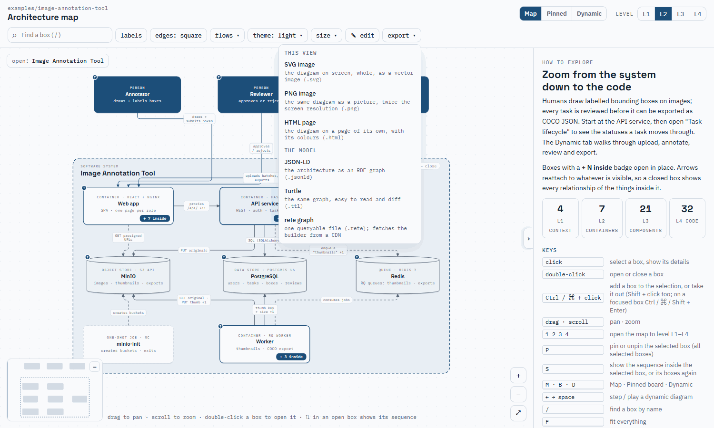

# RDF export

The architecture model behind the explorer is also an RDF graph: every element, relationship, scenario step and
state transition is a resource you can query.

{ .shot }

## Downloads

The explorer's **export** menu downloads the graph as:

- **JSON-LD**, generated in the browser.
- **`.rete`**, a single-file RDF graph you can host anywhere and query with SPARQL without a database server. It is
  built in the browser with [rete](https://github.com/caviri/rete); this one button needs a network connection,
  the rest of the page does not.

The build also writes `architecture.jsonld` next to the page, and `architecture.rete` when the `rete` CLI or the
`rete-graph` npm package is installed. Otherwise:

```sh
rete build architecture.jsonld -o architecture.rete --card --title "My project architecture"
```

## Try it on the example

The example's graph is published with these docs:
[`architecture.jsonld`](https://github.com/caviri/c4-model-agentic-plugin/blob/main/examples/image-annotation-tool/communications/architecture-explorer/architecture.jsonld)
on GitHub, or use the export menu in the [live explorer](example/explorer.md).

## Vocabulary and queries

The [RDF graph reference](reference/explorer-rdf-graph.md) has the IRIs, the vocabulary, the mapping from each
model field, and example SPARQL queries: containers and their technologies, everything that depends on one
element, what an element uses, the steps of a scenario in order, state transitions, and elements nothing points at.
