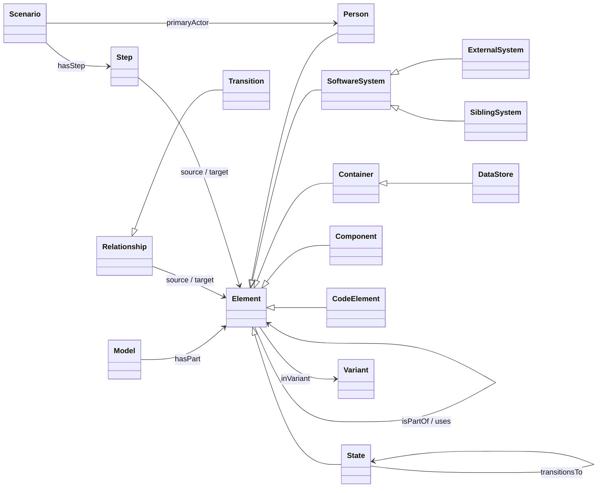

# The C4 architecture ontology

The architecture explorer describes a codebase with the [C4 model](https://c4model.com/): people, software systems, containers, components and code, how they relate, and how they collaborate in runtime scenarios. This folder gives that description a formal vocabulary, so the RDF graph every explorer exports means something outside the plugin.

**The graph is the architecture, complete.** Every explorer page exports its model as RDF (Turtle, JSON-LD, N-Triples, `.rete`), and the graph holds everything needed to **recreate every diagram**: the map at every level, each lifecycle, and every use case as a collaboration or sequence diagram. A page rebuilt from the graph alone is identical to the original (the plugin checks this with `check-roundtrip.mjs`).

The C4 model is Simon Brown's work. This ontology is an independent formalisation of it for this plugin; it is not endorsed by Simon Brown or by c4model.com.

## Files

| File | What | IRI |
|---|---|---|
| [`c4.ttl`](c4.ttl) | **Core**: the architecture. OWL 2 | `https://caviri.github.io/c4-model-agentic-plugin/ontology/c4`, terms `c4:` = `…/ontology/c4#` |
| [`c4-view.ttl`](c4-view.ttl) | **View**: how the explorer draws it. OWL 2, imports the core | `…/ontology/c4-view`, terms `c4v:` = `…/ontology/c4-view#` |
| [`c4-shapes.ttl`](c4-shapes.ttl) | SHACL shapes every exported graph meets | `…/ontology/c4-shapes.ttl` |
| [`alignments.ttl`](alignments.ttl) | optional SKOS mappings to schema.org, Dublin Core, PROV-O | `…/ontology/alignments.ttl` |
| [`EXTENDING.md`](EXTENDING.md) | how to add terms of your own, with a worked example | |
| [`examples/deployment.ttl`](examples/deployment.ttl), [`examples/deployment-shapes.ttl`](examples/deployment-shapes.ttl) | that example: deployment facts and data classification | `https://example.org/ontology/deployment` |

All of them are published with the documentation site under <https://caviri.github.io/c4-model-agentic-plugin/ontology/>, so the namespaces resolve: `https://caviri.github.io/c4-model-agentic-plugin/ontology/c4#Container` opens the [term reference](https://caviri.github.io/c4-model-agentic-plugin/ontology/c4/) at *Container*, and `/ontology/c4.ttl` downloads the Turtle. Version 0.1.0, Apache-2.0, like the rest of the repository.

## Core and view

The ontology has two modules, in the spirit of BPMN's separation of model and Diagram Interchange:

- **`c4:` (core)** says what the architecture *is*: elements, relationships, scenarios and their steps, states, use cases, sources in the repository. This is what you query, merge with other graphs, or reason over.
- **`c4v:` (view)** says how the explorer *shows* it: the order of every list, grid positions inside a box, colours and dashed lines, which boxes the map opens with, the pinned board, the legend, level names, toolbar texts, link templates. Every `c4v:` property is an OWL annotation property, so a reasoner draws no conclusions from it.

A consumer that only cares about the architecture can drop every `c4v:` triple and lose nothing of its meaning. Recreating the page needs both.

## The C4 levels as classes

| Level | C4 abstraction | Class | Explorer node `type` |
|---|---|---|---|
| 1 · System context | person | `c4:Person` | `person` |
| 1 | software system | `c4:SoftwareSystem`, with `c4:ExternalSystem` (not yours) and `c4:SiblingSystem` (yours, outside the boundary) | `system`, `ext`, `sibling` |
| 2 · Containers | container (an application or a data store) | `c4:Container`, with `c4:DataStore` | `container`, `store` |
| 3 · Components | component | `c4:Component` | `component` |
| 4 · Code | code element | `c4:CodeElement` | `code` |
| owner + 1 | state of a lifecycle (beyond core C4) | `c4:State` | `state` |

All of them are `c4:Element`s and carry their level as `c4:level`. Containment is `dcterms:isPartOf` (and `dcterms:hasPart` the other way); top-level elements are part of the `c4:Model`. The exported data writes every superclass out (a data store is typed `c4:Element`, `c4:Container` and `c4:DataStore`), so SPARQL without a reasoner and SHACL see the hierarchy.



`Person`, `SoftwareSystem`, `Container`, `Component`, `CodeElement` and `State` are pairwise disjoint, as are `Element`, `Relationship`, `Model`, `Variant`, `Scenario` and `Step`; so are `ExternalSystem` and `SiblingSystem`.

## Relationships

Every relationship is a resource, `c4:Relationship`, with exactly one `c4:source`, one `c4:target` and a label (`rdfs:label`: what happens along it, such as `POST /orders`). `c4:summaryLabel` names the higher-level relationship it belongs to, which the explorer shows when both ends are folded into their containers. For quick queries the exporter also writes a shortcut triple, `source c4:uses target`.

## Use cases: scenarios and steps

A `c4:Scenario` is a C4 [dynamic diagram](https://c4model.com/diagrams/dynamic): numbered `c4:Step`s (`c4:hasStep`, ordered by `schema:position`), each a message from a `c4:source` element to a `c4:target` element, with a label and, for an answer, `c4:isReply true`. The explorer draws the same scenario as a collaboration diagram, a sequence diagram or a step table, at any level.

A scenario can also be read as a **use case** (beyond core C4, after Cockburn's template). All optional:

| Property | Model field | Meaning |
|---|---|---|
| `c4:primaryActor` | `actor` | the person (`c4:Person`) whose goal it serves |
| `c4:goal` | `goal` | what that person wants |
| `c4:trigger` | `trigger` | the event that starts it |
| `c4:precondition` | `preconditions` | what must hold before it starts, one value each |
| `c4:outcome` | `outcome` | what holds when it has succeeded |

## States and transitions

A lifecycle (the status of an order, a task) is a set of `c4:State`s inside the element that owns it, one level below it. Moves between states are `c4:Transition`s, relationships whose ends are both states and whose label is the event; the shortcut is `c4:transitionsTo`. `c4:initial` and `c4:final` mark where the lifecycle starts and ends. States are an extension beyond core C4.

## An example

From the graph of the [example project](https://caviri.github.io/c4-model-agentic-plugin/example/) (`examples/image-annotation-tool`), trimmed. In Turtle the empty prefix `:` is the model's own base IRI.

```turtle
@prefix c4: <https://caviri.github.io/c4-model-agentic-plugin/ontology/c4#> .
@prefix c4v: <https://caviri.github.io/c4-model-agentic-plugin/ontology/c4-view#> .
@prefix rdfs: <http://www.w3.org/2000/01/rdf-schema#> .
@prefix dcterms: <http://purl.org/dc/terms/> .
@prefix schema: <https://schema.org/> .
@prefix : <urn:architecture:image-annotation-tool:> .

:postgres a c4:Element, c4:Container, c4:DataStore ;
    rdfs:label "PostgreSQL" ;
    dcterms:identifier "postgres" ;
    c4:tag "DATA STORE · POSTGRES 16" ;
    c4:level 2 ;
    c4:technology "PostgreSQL 16" ;
    c4:path "db/migrations/001_init.sql" ;
    dcterms:isPartOf :iat ;
    c4v:order 8 ;
    c4v:column 1 ;
    c4v:row 1 .

:st-submitted a c4:Element, c4:State ;
    rdfs:label "submitted" ;
    c4:level 4 ;
    dcterms:isPartOf :lifecycle ;
    c4:transitionsTo :st-approved, :st-rejected .

:rel:35 a c4:Relationship, c4:Transition ;
    c4:source :st-pending ;
    c4:target :st-in-progress ;
    rdfs:label "claim · annotator" ;
    c4v:order 35 .

:scenario:annotate a c4:Scenario ;
    rdfs:label "Annotate + submit" ;
    c4:primaryActor :annotator ;
    c4:goal "Get the next image annotated with labelled boxes and handed over for review." ;
    c4:trigger "The annotator opens /annotate, which asks the API for the next task." ;
    c4:outcome "The task is submitted with at least one box (an empty submit is refused with 422) and appears in the review queue." ;
    c4:hasStep :step:annotate:1, :step:annotate:2, :step:annotate:3 .

:step:annotate:3 a c4:Step ;
    c4:inScenario :scenario:annotate ;
    schema:position 3 ;
    c4:source :client ;
    c4:target :claim-next ;
    rdfs:label "POST /api/tasks/next" .
```

## From the explorer to the graph and back

The mapping lives in one place, the template's `<script id="rdf">` (`window.archRdf`), used by the page's export menu, its editor, and the build scripts. Field by field it is documented in the explorer's [RDF graph reference](https://caviri.github.io/c4-model-agentic-plugin/reference/explorer-rdf-graph/) (`skills/architecture-explorer/references/rdf-graph.md`), which also lists the few documented normalisations of the way back.

- **Out:** the page's `export ▾` menu (JSON-LD, Turtle, `.rete`), the editor's download bar, and `build-explorer.mjs`, which writes `architecture.jsonld` and `architecture.ttl` next to every page.
- **Back:** `archRdf.fromTriples(triples)` rebuilds the model; `model-from-rdf.mjs graph.ttl model.js` writes it, and `build-explorer.mjs graph.ttl index.html` builds the page straight from a graph.
- **Your own terms:** an `rdf` object on any node, edge or scenario, with the namespaces declared in `MODEL.rdf.prefixes`; see [EXTENDING.md](EXTENDING.md).

## Validate with SHACL

[`c4-shapes.ttl`](c4-shapes.ttl) checks what a graph must meet: one label, id, level (1–4) and parent per element; exactly one source and one target element and a label per relationship; position, source, target and scenario per step; containers inside software systems and components inside containers; transitions between states; a person as the primary actor; an order for everything the explorer lists. It is SHACL Core without `sh:or`/`sh:not`, so every engine gives the same report.

```sh
pip install pyshacl
pyshacl -s c4-shapes.ttl -df turtle architecture.ttl
```

```js
// rete-graph (npm), in Node or the browser
const g = await rete.open(await rete.build(turtle, 'ttl'));
console.log(g.shacl(shapesTurtle));      // { conforms: true, results: [] }
```

Any SHACL engine works (Apache Jena `shacl validate`, TopBraid, RDF4J). The shapes need only the data graph: the exported data names its superclasses itself.

Domain and range axioms in `c4.ttl` are few on purpose. They make a reasoner *infer* (anything that `c4:uses` something is a `c4:Element`), they never report an error. Checking is what the shapes are for.

## Download and query

| Format | From |
|---|---|
| Turtle `.ttl` | the page's export menu, or `architecture.ttl` next to a built page |
| JSON-LD `.jsonld` | the same places |
| `.rete` | the export menu (fetches the builder once), or `build-explorer.mjs` with the `rete` CLI or the `rete-graph` package |

A `.rete` file is a whole graph in one file, queryable with SPARQL without a server:

```sh
rete build architecture.ttl -o architecture.rete
rete sparql architecture.rete 'PREFIX c4: <https://caviri.github.io/c4-model-agentic-plugin/ontology/c4#>
  PREFIX rdfs: <http://www.w3.org/2000/01/rdf-schema#>
  SELECT ?scenario ?actor WHERE { ?s a c4:Scenario ; rdfs:label ?scenario ; c4:primaryActor/rdfs:label ?actor }'
```

The RDF graph reference has eight tested queries: containers and their technologies, everything that depends on an element, what an element uses, the steps of a scenario, use cases, state transitions, elements nothing points at, and the layout of a box.

## Extending it

Add terms in a namespace of your own, never in `c4:`; prefer subclasses and subproperties; give every term a label, a definition and a source; ship SHACL shapes with them. [EXTENDING.md](EXTENDING.md) says why and how, with a worked example from model fields to Turtle and a SPARQL query.

## Versioning

`owl:versionInfo "0.1.0"`. Until 1.0, terms may still change; every change is listed here. From 1.0 on, each release gets an `owl:versionIRI` whose file stays published, and terms are deprecated (`owl:deprecated true`, `dcterms:isReplacedBy`) for at least one minor version before they go.

**Changes from the earlier, unpublished vocabulary** (`arch:` = `urn:arch-explorer:vocab#`, used by exports before 0.1.0):

| Before | Now | Why |
|---|---|---|
| `arch:` *Term* | `c4:` *Term* | a published, dereferenceable namespace |
| `arch:step` | `c4:hasStep` | a class and a property differed only in case (`Step`, `step`) |
| `arch:scenario` | `c4:inScenario` | the same; pairs with `c4:inVariant` |
| `arch:reply` | `c4:isReply` | a boolean reads as a flag |
| `arch:kind` | `c4v:style` | a colour, not a classification; presentation belongs to the view module |
| `arch:dashed` | `c4v:dashed` | presentation |

JSON-LD terms changed with them (`kind` → `style`, `step` → `hasStep`, `scenario` → `inScenario`, `reply` → `isReply`). Other differences: data stores are also typed `c4:Container` and external and sibling systems `c4:SoftwareSystem`; the model's `dcterms:identifier`, `c4:branch` and `c4:variantDimension` are written only when the model sets them; and everything in `c4v:`, the use-case properties and `dcterms:conformsTo` are new.

## Design decisions

- **IRIs on GitHub Pages.** The namespace lives on the project's documentation site, so it resolves today with no other service: a term IRI opens its documentation. The trade-off: the IRIs depend on the repository's name and host, and GitHub Pages cannot do content negotiation (a client asking for Turtle at `…/ontology/c4` gets HTML; the Turtle is at `…/ontology/c4.ttl`). A [w3id.org](https://w3id.org/) redirect (such as `https://w3id.org/c4-arch/`) would give permanent IRIs and content negotiation, and is the step to take before 1.0; changing the namespace then is what the rename table is for.
- **Hash namespaces.** All terms of a module are in one document, small enough to fetch whole; `…/c4#Container` needs no server rule.
- **Mappings, not equivalences.** Links to schema.org and others are SKOS mappings in a separate file. `owl:equivalentClass` would make a reasoner treat every `schema:SoftwareApplication` as a `c4:SoftwareSystem`, with all the C4 axioms.
- **Plain integers.** Levels, lines, positions and orders are written as `xsd:integer` literals, so a SPARQL pattern such as `c4:level 2` matches; the OWL ranges (`xsd:positiveInteger`) still hold, and the shapes check the bounds.
